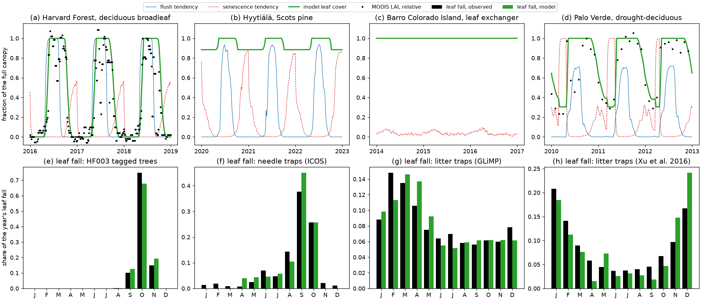
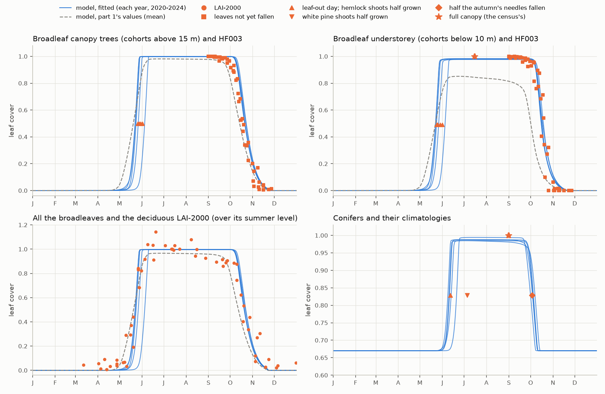
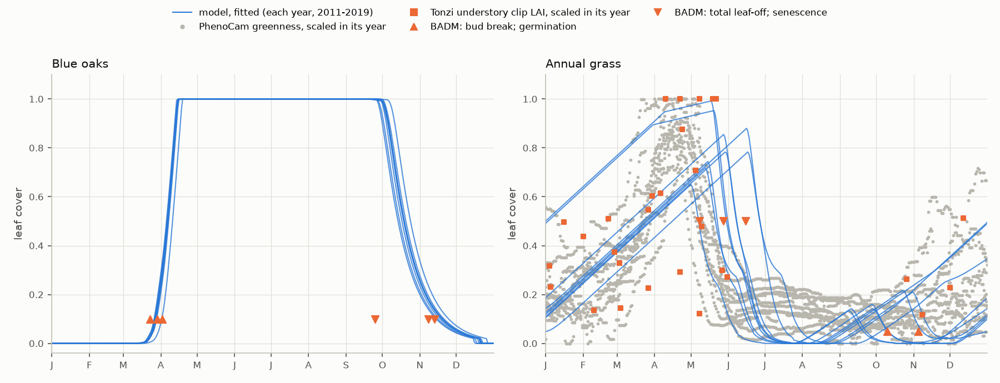

# Example 02 — Canopy phenology

The leaf-phenology module of ED-MORE, in three parts.
- **[Part 1](#part-1--the-module-at-four-forests)** shows how the module is built — one kernel, three
  cues, and leaf habits as parameter sets — at four forests. It is not a calibration of any of them.
- **[Part 2](#part-2--fitting-a-stand-harvard-forest)** fits it: the broadleaves and conifers of
  example 04's Harvard Forest stand, every cohort reading its own cues, with
  [`scripts/calibrate_phenology`](../../scripts/calibrate_phenology/README.md). Example 04 runs with
  those values.
- **[Part 3](#part-3--a-savanna-tonzi-ranch)** fits a savanna the same way: the blue oaks and the annual
  grass of example 04's Tonzi Ranch stand, the grass on the WATER cue.

Every habit runs the same compiled kernel
([`ed_plant_phenology.f90`](../../src/slow_dynamics/processes/ed_plant_phenology.f90)) and differs only
in parameter values. Python drives it through [`edmore.plant.pheno`](../../python/edmore/plant/pheno.py);
the equations are in [`docs/science/plant_phenology.md`](../../docs/science/plant_phenology.md).

## Part 1 — the module at four forests

A temperate deciduous broadleaf, an evergreen pine, a tropical tree that renews its leaves in the dry
season and a drought-deciduous dry forest.

### The module in brief

Each day the kernel moves two tendencies between 0 and 1, one for flushing leaves and one for
shedding them (senescence), from up to three cues chosen per side:

| Cue | Driver | Flush | Senescence |
|---|---|---|---|
| TEMP | daily air temperature (in the coupled model, the canopy air around the cohort) | enough warmth since midwinter | enough cold since midsummer |
| LIGHT | hours a day the light exceeds `par_min` (in the coupled model, at the cohort's top) | many hours | few hours, or many (a leaf exchanger) |
| WATER | predawn leaf water potential | wet long enough | dry long enough |

A low `par_min` counts every hour of daylight, so the cue is the day length; a high one counts only
the bright hours. Leaves grow at up to `flush_rate_max` times the flush tendency and fall at up to
`shed_rate_max` times the senescence tendency, down to `min_leaf_cover` of the full canopy. **An
evergreen is a canopy whose senescence stops above zero**, not a separate switch.

### Sites

| Site | Leaf habit | Cues: flush; senescence | Drivers | Observations |
|---|---|---|---|---|
| Harvard Forest, USA, 42.5° N | deciduous broadleaf | TEMP + LIGHT; TEMP + LIGHT | air temperature, light | MODIS LAI; leaf fall on tagged trees (HF003); litter baskets (HF069) |
| Hyytiälä, Finland, 61.8° N | evergreen Scots pine | TEMP + LIGHT; TEMP + LIGHT | air temperature, light | needle litter traps (ICOS) |
| Barro Colorado Island, Panama, 9.2° N | leaf exchanger | WATER; LIGHT + WATER | soil water as a stand-in for leaf water potential, light | litter traps (GLiMP) |
| Palo Verde, Costa Rica, 10.4° N | drought-deciduous | WATER + LIGHT; WATER + LIGHT | a simulated leaf water potential, light | leaf litter traps (Xu et al. 2016); MODIS LAI |

Part 1 drives each site with one series per day: the site's air temperature, and the hours of
ERA5-Land's light above the canopy as ED-MORE's forcing reader delivers it. The water
potential at Palo Verde is hypothetical: the canopy predawn value of an ED-MORE run of an evergreen
stand at the site, not of this forest.

### Run

Build the Python library once (as in [example 01](../example01_leaf_gas_exchange/README.md#run)),
then from the repository root:

```bash
python examples/example02_canopy_phenology/fetch_phenology_data.py          # once: data/, ~1 min
PYTHONPATH=python python examples/example02_canopy_phenology/run_phenology.py
```

The run takes a few seconds. It reads [`fitted_parameters.json`](fitted_parameters.json), prints the
parameters and scores, and writes `canopy_phenology.png`. `--fit` refits the parameters to the data
first (about 45 minutes on 40 cores). The records are short, so the fits capture each site's mean
seasonal cycle, not its year-to-year variation, and each fit holds the leaves shed per year to a
literature value (one canopy for the broadleaf forests, 0.3 for the pine).

The hours of light in `drivers/` are committed. Remaking them needs a built `edmore` (`--edmore`
or `EDMORE_MAIN`, default `build-dev/edmore`) and the processed ERA5-Land archive
([`scripts/prepare_input/era5`](../../scripts/prepare_input/era5)), named by `--archive` or the environment
variable `ERA5LAND_ARCHIVE`:

```bash
python examples/example02_canopy_phenology/make_era5_par_hours.py --archive /path/to/ED_ERA5land
```

### Results

The numbers here come from the first ED-MORE release, built with ifx and the production preset
(`cmake --preset production`).



**Top row:** model leaf cover and the two tendencies over three years at each site, with MODIS LAI
(relative to its seasonal peak) where it is used. **Bottom row:** each month's share of the year's
leaf fall, observed and modelled.

| | Harvard Forest | Hyytiälä | Barro Colorado Island | Palo Verde |
|---|---|---|---|---|
| `par_min` [µmol m⁻² s⁻¹]: what it counts | 2: day length | 100: bright hours | 1000: strong sun | 5: day length |
| `min_leaf_cover` | 0 | 0.88 | 0.80 | 0.30 |
| Leaves shed per year [canopies] | 1.0 | 0.30 | 1.0 | 1.0 |
| Leaf lifespan [yr] | 0.4 | 3.1 | 1.0 | 0.8 |

- **Harvard Forest.** Warmth and long days open the flush in May; cold and shortening days bring
  the leaves down, most of them in October. The day the canopy is half fallen is within 3 days of
  the tagged trees' on average, half green within 5 days of MODIS.
- **Hyytiälä.** The needles fall in September–October as the bright hours dwindle, and the canopy
  keeps 88 % of them through winter.
- **Barro Colorado Island.** Senescence follows the bright dry season (January–April) while the
  flush keeps refilling the canopy: the leaves turn over, the canopy stays full. The traps catch
  all fine litter, so this one habit stands for the whole community.
- **Palo Verde.** Most leaves fall as the days shorten (November–January), the drought takes the
  canopy to its floor late in the dry season, and the leaves return with the rains once the days
  lengthen. Water alone fits far worse: the litter peaks in December–January, before the simulated
  water potential falls below −3 MPa in February–March. Day length as a cue for both leaf fall and
  flushing is what Borchert & Rivera (2001) and Rivera et al. (2002) found in tropical dry forests.

## Part 2 — fitting a stand: Harvard Forest



Part 1 feeds the kernel the site's air and the light above the canopy. In the coupled model each
cohort reads its own: the canopy air of its patch and the hours of light at its top, which are fewer
under a closed canopy. Part 2 fits both PFTs of example 04's Harvard stand (its census, frozen; the
tower's forcing, 2019–2024) this way, with [`scripts/calibrate_phenology`](../../scripts/calibrate_phenology/README.md):
a coupled run gives every cohort's cues, the kernel is fitted on them offline, and the two alternate
until the values settle.

### Run

Prepare example 04's Harvard forcing and census first ([its README](../example04_column_biophysics/sites/harvard/README.md#run)), then:

```bash
cd examples/example02_canopy_phenology/harvard_stand
python prepare_observations.py           # the observations, from part 1's data/
python ../../../scripts/calibrate_phenology/calibrate_phenology.py iterate \
       --config phenology.toml --work ../data/harvard_stand_runs --workers 40
python plot_fit.py                       # harvard_stand.png
```

A round is a coupled run of the stand (about 5 minutes) and an offline fit (10–15 minutes) on one
40-core node. From example 04's values the fit settles in two rounds (31 minutes); from part 1's it
takes four, about an hour. The fit writes example 04's PFT file with its values to
`../data/harvard_stand_runs/pft_parameters_fitted.toml`; example 04's file carries them.

### What is fitted

[`phenology.toml`](harvard_stand/phenology.toml) fits 12 keys:
- **the broadleaves** (PFT 1): the warmth and day length that open the flush and its rate, and the cold,
  its base temperature and the day length that bring the leaves down, and their rate;
- **the conifers** (PFT 2): the warmth and day length of their June flush, the cold and day length that
  start the needle fall, and the needles lost through the season.

Three of the conifers' traits are set, not fitted: their winter floor (two thirds of the needles; a
needle lives about three years), a sharp day-length gate (they flush once), and a `par_min` of 0.5
µmol m⁻² s⁻¹ (at 2, a conifer under the broadleaf canopy counts too few hours of light in June to
refill). The tool's README explains each.

### Results

| target | cohorts | model − observed (RMSE) |
|---|---|---|
| HF003, leaf-out day of the canopy species | broadleaves above 15 m | −2.2 days (3.8) |
| HF003, leaf-out day of the understorey species | broadleaves below 10 m | −0.5 days (2.5) |
| HF003, leaves fallen, canopy species | broadleaves above 15 m | −0.06 of the canopy (0.09) |
| HF003, leaves fallen, understorey species | broadleaves below 10 m | −0.02 (0.07) |
| full in mid-July | broadleaves below 10 m | −0.02 |
| LAI-2000, deciduous, over its summer level | all broadleaves | −0.03 (0.13) |
| EMS baskets, share of the autumn's litter | all broadleaves | +0.06 (0.10) |
| canopies lost a year (1) | all broadleaves | +0.01 |
| MODIS, scaled within each year | the whole stand | +0.05 (0.17) |
| hemlock shoots half grown (day 163) | conifers | +0.9 days (4.4) |
| white pine shoots half grown (day 186) | conifers | −22.4 days |
| half the autumn's needles fallen (day 276) | conifers | +1.2 days (2.4) |
| needles lost a year (0.35) | conifers | +0.00 |
| full at the end of August | conifers | −0.01 |

- **The cohorts' own cues change the answer.** With part 1's values (the dashed lines), fitted to the
  site's air and the light above the canopy, the understorey fills only two thirds and falls two to
  three weeks early, because its light cue reads the fewer hours under the canopy. With the cohorts'
  own cues, the broadleaves need more warmth to flush (264 against 92 K day above 5 °C) and more cold to
  drop (169 K day below 292.0 K, against 48 below 290.3 K).
- **The conifers** keep two thirds of their needles from October to June, grow their shoots in June
  and are full by the end of August; the needles fall in early October. White pine's shoots, the
  loosest target (a 20-day spread), lose to hemlock's.
- **The fit settled**, and the offline stand matched each coupled run's leaf cover to within 0.002.

## Part 3 — a savanna: Tonzi Ranch



Two canopies that take turns: blue oaks, in leaf from April to October, over a C3 annual grass, green
from the first big autumn rain to May. The grass has one cue, WATER: its predawn leaf water potential
summed above its turgor-loss point sets it growing, and summed below it kills it. The fit is example
04's Tonzi stand (the oak census at the field survey's size distributions and its grass, frozen; the tower's forcing, 2010–2019).

### Run

Prepare example 04's Tonzi forcing and census first ([its README](../example04_column_biophysics/sites/tonzi/README.md#run)), then:

```bash
cd examples/example02_canopy_phenology/tonzi_stand
python prepare_observations.py --ton-badm <base>/AMF_US-Ton_BASE-BADM_27-5.zip \
       --var-badm <base>/AMF_US-Var_BASE-BADM_27-5.zip --phenocam <phenocam folder>
python ../../../scripts/calibrate_phenology/calibrate_phenology.py iterate \
       --config phenology.toml --work ../data/tonzi_stand_runs --workers 60
python plot_fit.py                       # tonzi_stand.png
```

The BADM workbooks are AmeriFlux's BASE-BADM zips (an account); the PhenoCam folder holds
`tonzi_GR_1000_1day.csv` (phenocam.nau.edu). A round is a coupled run (about a minute) and an offline fit
(5–10 minutes) on 60 cores.

### What is fitted

[`phenology.toml`](tonzi_stand/phenology.toml) fits 8 keys:
- **the oaks** (PFT 1): the warmth their buds wait for, and the cold that drops the canopy, its base and
  its sum. They flush on warmth and long days: on warmth alone, summed from midwinter and still high in
  autumn, they would flush again all autumn. Their day-length gate is Harvard's broadleaves' (part 2),
  their flush and fall rates the repository's: three scored years of BADM dates cannot tell the rates
  from the cues;
- **the grass** (PFT 2): the wet sum that sets it growing and how fast it fills, and the dry sum, its
  sharpness and the rate that kill it.

The oak crowns' camera is not a target: their greenness peaks with the young leaves and falls all
summer while the leaf area holds.

### Results

| target | model − observed (RMSE) |
|---|---|
| oak bud break (BADM, 2011–2013) | +1 day (2.5) |
| oak total leaf-off (BADM, 2011–2013) | +21 days (30) |
| grass germination (BADM, 2011–2012) | +6 days (40) |
| grass senescence (BADM, 2011–2013) | +8 days (9) |
| grass PhenoCam greenness, scaled within each year | +0.05 (0.24) |
| understory clip LAI, scaled within each year | +0.13 (0.32) |
| canopies lost a year (1), oaks / grass | +0.08 / −0.01 |

- **The grass fills over the winter**, at 0.45 % of its full canopy a day once the wet sum has reached
  91 MPa day, and dies in May and June within days of the dry sum's 4.4 MPa day. Its peak follows the
  year's rain: lower in the dry winters of 2013–2015.
- **Germination is the weak target.** One first rain can come in September and the next only in
  November: the grass started 34 days early in 2011 and 45 days late in 2012.
- **The oaks miss the dry year's early fall.** In 2013 they lost their leaves on day 268; the model
  drops them on day 318. Their drought sum is not fitted, and their summer potentials (−2 to −2.5 MPa)
  stay too close to their turgor-loss point for it to act.
- **The fit does not settle.** The grass's leaves dry the soil whose potential is its cue, so each fit,
  made on the last run's cues, overshoots on its own run. The tool keeps the values whose own coupled
  run scored best (the fourth of six); the oaks' keys settled.

## Files

- [`fetch_phenology_data.py`](fetch_phenology_data.py) — downloads the Harvard Forest, Hyytiälä and
  BCI data into `data/` (not tracked) and cites the sources.
- [`run_phenology.py`](run_phenology.py) — part 1: the sites, the fit, the scores and the figure.
- [`fitted_parameters.json`](fitted_parameters.json) — the fitted parameters of the four habits.
- [`drivers/`](drivers) — committed inputs: the hours of light at each site
  (`era5_par_hours_<site>.csv.gz`, made by [`make_era5_par_hours.py`](make_era5_par_hours.py) from
  the ERA5-Land archive) and Palo Verde's simulated water potential, monthly leaf litter and monthly
  MODIS LAI.
- `canopy_phenology.png` — part 1's figure.
- [`harvard_stand/`](harvard_stand) — part 2: [`phenology.toml`](harvard_stand/phenology.toml) (the fit's
  keys and targets), [`prepare_observations.py`](harvard_stand/prepare_observations.py) (HF003, HF069
  and MODIS into the tool's files, in `data/harvard_stand/`), [`plot_fit.py`](harvard_stand/plot_fit.py)
  and its figure.
- [`tonzi_stand/`](tonzi_stand) — part 3: [`phenology.toml`](tonzi_stand/phenology.toml),
  [`prepare_observations.py`](tonzi_stand/prepare_observations.py) (the BADM's dates and clip LAI and the
  grass's PhenoCam greenness, in `data/tonzi_stand/`), [`plot_fit.py`](tonzi_stand/plot_fit.py) and its
  figure.

References: Borchert, R. & Rivera, G. (2001) *Tree Physiology* 21: 213–221; Rivera, G. et al.
(2002) *Trees* 16: 445–456; Xu, X. et al. (2016) *New Phytologist* 212: 80–95.
