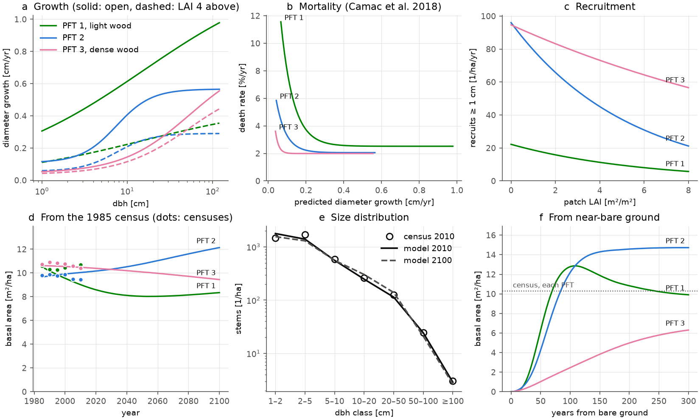

# Example 03 — Demography

The demography module of ED-MORE on its own: cohorts, patches, their fusion and fission, recruitment
and treefall disturbance, with no carbon, water or energy. **This example shows how the module runs
on vital rates handed to it from outside; it is not a calibration.** Here those rates are three
simple laws fitted to the censuses of the Barro Colorado Island (BCI) 50-ha plot, and a Python driver
passes them to the engine's law-free apply-primitives through
[`edmore.demography`](../../python/edmore/demography/_site.py) (`Site.apply_rates`).

## The laws

| Law | Rate | Form | Fitted by |
|---|---|---|---|
| growth | dbh growth g [cm/yr] per cohort | g = [g_min + (g_max − g_min) / (1 + (D/D₀)^−k)] · e^(−b·L) | Gamma quasi-likelihood |
| mortality | death rate m [1/yr] per cohort | m = γ + α · e^(−β·g) (Camac et al. 2018) | maximum likelihood, P(die in Δt) = 1 − e^(−m·Δt) |
| recruitment | new stems ≥ 1 cm [1/m²/yr] per PFT and patch | R = exp(c₀ + c₁·LAI) | Poisson GLM, weighted by area × Δt |

| PFT | wood density [g cm⁻³] | g_min [cm/yr] | g_max [cm/yr] | D₀ [cm] | k | b | γ [1/yr] | α [1/yr] | β [yr/cm] |
|---|---|---|---|---|---|---|---|---|---|
| 1 | 0.36 | 0.03 | 1.33 | 15 | 0.5 | 0.25 | 0.025 | 0.25 | 15 |
| 2 | 0.50 | 0.11 | 0.57 | 7 | 2.1 | 0.17 | 0.021 | 0.09 | 19 |
| 3 | 0.68 | 0.04 | 0.77 | 54 | 1.1 | 0.06 | 0.020 | 0.15 | 59 |

- **Growth** rises with dbh D from g_min to g_max, half-way at D₀, and shade shrinks it by e^(−b·L).
  L is the overtopping LAI, the leaf area of taller trees per m² of ground: the competition index the
  engine computes for every cohort (`overtopping_lai`), which the driver reads as it is. For each
  census tree it is the leaf area of taller trees within 20 m, with height and leaf area from ED-MORE's
  allometry; trees of equal height share a layer, as in the engine. Zero and negative
  increments (the tape's millimetre, or a broken stem) are set to a tenth of the smallest positive
  one, 0.0017 cm/yr, which raises the census's mean growth from 0.071 to 0.081 cm/yr.
- **Growth is that of every tree alive at an interval's start**, as a cohort's is. The census
  measures growth only on the trees that live to the next census, and the slowest growers are the
  likeliest to die, so a tree that dies within an interval keeps the growth it put on over the
  interval before. That needs a census before it, so growth is fitted on 1990–2010, where 13 % of the
  rows are trees that died. They lower the mean growth of 1–2 cm stems by 10–30 % (most for PFT 1),
  and of stems above 5 cm by less than 8 %.
- **Mortality** depends on growth alone, as in Camac et al. (2018), who fitted the same form to the BCI
  censuses. Its growth is the growth law's, not the tree's measured growth: a cohort's growth is the
  law's too.
- **Recruitment** depends on the leaf area index of the patch, all PFTs' together (LAI) -- in the
  census, the leaf area within 20 m of a quadrat's centre. It is shade, not seed source: a PFT's own
  leaf area nearby does not raise its recruitment in the census. Trees and quadrats within 20 m of the
  plot's edge are not fitted.
- **PFTs are wood-density classes**: species' wood density from the Global Wood Density Database
  ([`bci_wood_density.csv`](bci_wood_density.csv): neotropical entries, species → genus → family),
  split at 0.42 and 0.58 g cm⁻³ so each class holds a third of the 1985 basal area.
- **Height follows Barro Colorado's own curve**, a log-quadratic fitted to Cano et al. (2019)'s curve
  for 9884 trees of the Barro Colorado Nature Monument: ln H = 0.8898 + 0.7908 ln D − 0.04923 (ln D)²
  [m], 32.7 m at 1 m dbh and 44.6 m at 3 m, within 4.3 % of Cano's curve (`[allometry]
  height_allometry = "chave2014"`). Leaf area and biomass take this height.
- **A tree is one stem**, as in ED-MORE: a tree that loses its main stem has died, and returns as a
  recruit when a stem is measured again. Recruits enter at the census's 1 cm (`min_cohort_height`
  2.435 m on the BCI curve).
- **Treefall** (`patch_disturbance_rate` 0.014 yr⁻¹) kills canopy trees above 10 m on the disturbed
  area. The census counts those deaths too, so the driver takes the rate off the mortality of
  cohorts tall enough to die in a gap.

The coefficients are in [`vital_rates.json`](vital_rates.json); [`census_laws.py`](census_laws.py)
evaluates the three formulas each step.

## Data

The BCI 50-ha plot censuses 2–7 (1985–2010), Condit et al. 2019, Dryad
[doi:10.15146/5xcp-0d46](https://doi.org/10.15146/5xcp-0d46), CC0; the PIs ask to be told of papers
that use it. Dryad refuses scripts, so download `bci.tree.zip` in a browser and export the tree
tables `bci.tree2` … `bci.tree7` as `bci_1985.csv` … `bci_2010.csv`. The 1982 census is not used: it
rounded small stems to 5 mm. Only processed summaries are committed: the coefficients and
[`census_stand.csv`](census_stand.csv) (stems, basal area and aboveground biomass by PFT and size class,
per census).

## Run

Build the Python library once (as in [example 01](../example01_leaf_gas_exchange/README.md#run)),
then from the repository root:

```bash
E=examples/example03_demography
python $E/prepare_census.py /path/to/bci_census   # tables in $E/data/, the 1985 stand, census_stand.csv
python $E/fit_vital_rates.py                      # scikit-learn, scipy; ~2 min -> vital_rates.json
PYTHONPATH=python python $E/run_demography.py --start census   # 1985 to 2100 -> output/census.nc
PYTHONPATH=python python $E/run_demography.py --start bare     # 300 years   -> output/bare.nc
python $E/plot_demography.py                      # demography.png
python $E/plot_site_timeseries.py     $E/output/bare.nc -o $E/output/timeseries.png
python $E/plot_forest_structure.py    $E/output/bare.nc -o $E/canopy_profile.gif
python $E/plot_landscape_3d.py        $E/output/bare.nc -o $E/landscape_3d.png
python $E/animate_landscape_growth.py $E/output/bare.nc -o $E/landscape_growth_3d.gif
```

The bare-ground run needs only the committed coefficients; the census run also needs the 1985 stand
that `prepare_census.py` writes.

## Results



**Top row:** the three laws. **Bottom row:** a run from the 1985 census beside the next five
censuses, the size distribution in 2010, and a run from near-bare ground.

| Cross-validated on 1-ha blocks | trees (quadrats) | class means |
|---|---|---|
| growth, R² | 0.10 | 0.88 |
| mortality, AUC / R² | 0.60 | 0.83 |
| recruitment, R² | 0.30 | plot total 111 stems ha⁻¹ yr⁻¹ (observed 110) |

| | stems ha⁻¹ | ≥ 10 cm ha⁻¹ | basal area m² ha⁻¹ | by PFT 1 / 2 / 3 |
|---|---|---|---|---|
| census 1985 | 4841 | 414 | 31.1 | 10.6 / 9.8 / 10.7 |
| census 2010 | 4145 | 416 | 30.5 | 10.7 / 9.4 / 10.4 |
| model 2010, from the 1985 census | 4116 | 389 | 29.5 | 9.0 / 10.0 / 10.5 |
| model 2100, from the 1985 census | 3870 | 465 | 29.9 | 8.3 / 12.1 / 9.4 |
| model, 100 years from bare ground | 4092 | 494 | 27.4 | 12.8 / 12.2 / 2.5 |
| model, 300 years from bare ground | 3841 | 467 | 30.9 | 9.9 / 14.7 / 6.3 |

- **From the census, the module tracks the plot's stems for 25 years**, the decline and the size
  distribution class by class, but runs low on the larger trees: in 2010, 389 trees above 10 cm
  against 416 and 29.5 m² ha⁻¹ of basal area against 30.5, most of the shortfall PFT 1's.
- **Run on to 2100, the stand holds its basal area**: it dips to 28.8 m² ha⁻¹ around 2040 and
  recovers to 29.9, as PFT 2 gains and PFT 3 loses. These are BCI's present rates run forward, not a
  prediction.
- **From bare ground the stand goes through a succession.** Under an open canopy the light-wooded
  PFT 1 grows fastest and rises with PFT 2, within 2 % of the census's basal area by 142 years;
  as the canopy closes PFT 1 declines, PFT 2 holds the canopy, and the dense-wooded PFT 3 builds up
  slowly beneath. Basal area ends 1 % above the census's; the canopy thins upward to 44 m, as the
  census stand does on the same height curve.

<p align="center">
  
  &nbsp;&nbsp;
  
</p>

The near-bare-ground run as the leaf-area profile beside a stand cross-section (left), and as a
synthetic landscape whose trees keep their place as they grow (right); green PFT 1, blue PFT 2,
magenta PFT 3. [`landscape_3d.png`](landscape_3d.png) is its last year. The two animations are
assets of the v0.4.1 release; the commands under Run remake them.

## Plotting the stand file

`run_demography.py` writes the stand once a year to `output/<start>.nc`, with plain names: per cohort
`pft`, `dbh`, `height`, `nplant`, `agb`, `leaf_area`, `owner_patch`, `global_cohort_id`; per patch
`patch_area`, `patch_age`, `dist_type`, `global_patch_id`; per record `n_cohort`, `n_patch`, `year`
and the site totals `total_nplant`, `total_lai`, `total_agb`, `total_basal_area`, `mean_dbh`. Four
scripts here read it. They need numpy, matplotlib and netCDF4, and the two 3-D renderers also the
`viz` extra (`pip install -e python/[viz]`: pyvista and scipy). Without `-o`, each writes next to its
input; `--help` lists the options.

- **`plot_site_timeseries.py`** — plant number, leaf area index, aboveground biomass, basal area,
  mean diameter, and cohort and patch counts; and a second figure, `<out>_pft.png`, of aboveground
  biomass by PFT (each cohort weighted by its patch's area), in the ED colours (PFT 1 green, 2 blue,
  3 magenta).
- **`plot_forest_structure.py`** — two panels on one height axis: the site's LAI in 2 m layers, and
  a cross-section in which each cohort is a horizontal bar (the flat canopy seen edge-on) at its
  height, thick in proportion to its LAI, coloured by PFT. Patches sit side by side from oldest to
  youngest, wide in proportion to area, in the same slot every frame.
- **`plot_landscape_3d.py`** — an area-weighted Voronoi mosaic of the patches at one record
  (`--time`, default the last), each filled with allometric tree crowns shaded by the leaf area
  above them. `--interactive` opens a window.
- **`animate_landscape_growth.py`** — the same landscape over every record. Each cohort keeps its
  `global_cohort_id`, so a tree stays in place as it grows; positions are laid out from the last
  record backward, and recruits are scattered into the gaps.

These read this file only. The diagnostic files `edmore` writes name their variables by level
(`mean_agb_py`, `nplant_co`, ...); example 05's `plot_pft_size.py` reads those.

## Files

| File | |
|---|---|
| [`prepare_census.py`](prepare_census.py), [`fit_vital_rates.py`](fit_vital_rates.py) | the census tables, and the three laws fitted to them |
| [`census_laws.py`](census_laws.py), [`run_demography.py`](run_demography.py) | the laws the driver applies, and the driver |
| [`plot_demography.py`](plot_demography.py) | the figure |
| [`plot_site_timeseries.py`](plot_site_timeseries.py), [`plot_forest_structure.py`](plot_forest_structure.py), [`plot_landscape_3d.py`](plot_landscape_3d.py), [`animate_landscape_growth.py`](animate_landscape_growth.py) | renders of the stand file: its totals, the canopy profile, the 3-D landscape and its animation |
| [`example_config_main.toml`](example_config_main.toml), [`example_config_pft.toml`](example_config_pft.toml) | the demographic settings, treefall, the census file, the PFTs |
| `_cadence.py`, `_write_nc.py` | the monthly and yearly steps; the netCDF the renders read |
