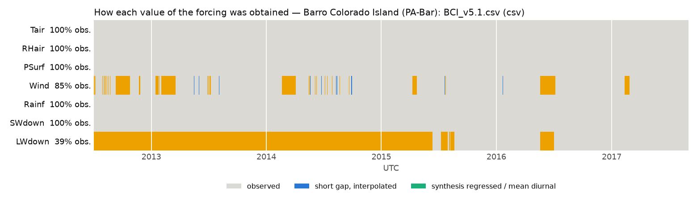
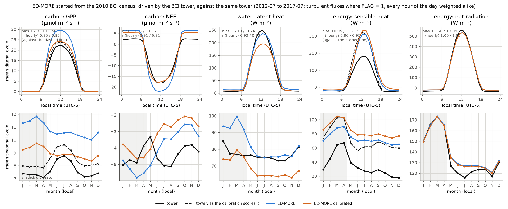
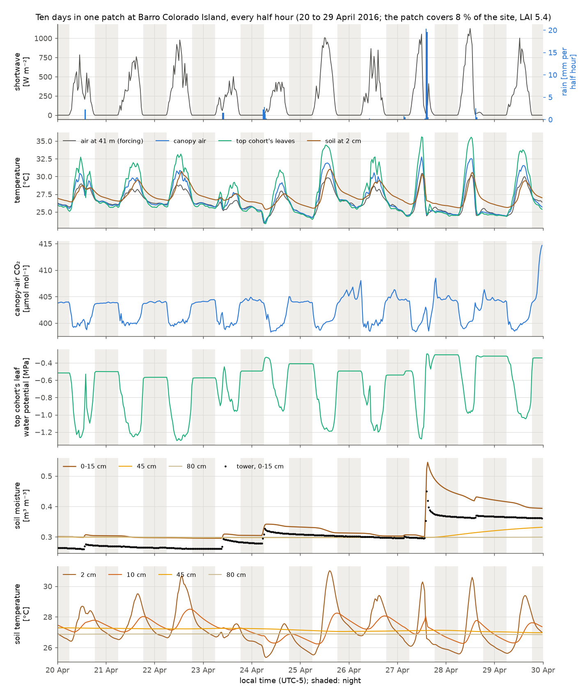

# Example 04, Barro Colorado Island — the column at the BCI flux tower

The coupled column of ED-MORE — canopy radiation, leaf gas exchange, the energy balances of leaves,
canopy air and soil, plant hydraulics, and the soil's water and heat — solved every 15 minutes in
each patch of a forest. The site is the Barro Colorado Island (BCI) flux tower in Panama (AmeriFlux
PA-Bar, 41 m above a seasonal tropical forest), over its five years, 2012–2017. How the column is
solved: [`docs/science/coupled_biophysics.md`](../../../../docs/science/coupled_biophysics.md).

The example:

1. builds an ED-MORE forcing file from the tower's own meteorology;
2. starts the forest from the 2010 census of the BCI 50-ha plot, with no spin-up;
3. calibrates the fast (sub-daily) parameters against the same tower;
4. compares the default and the calibrated runs with the tower's fluxes;
5. reruns ten days at half-hourly output to show what the column solves.

## Run

```bash
cd examples/example04_column_biophysics/sites/bci
python run_site.py --forcing-only                     # the data, the forcing and its figures
python run_site.py --census-dir /path/to/bci_census   # every step, with the shipped calibration
python run_site.py --calibrate --workers 40           # ... and redo the calibration first
```

It needs numpy, pandas, netCDF4, matplotlib and a built `edmore` (`--edmore` or `EDMORE_MAIN`,
default `../../../../build-dev/edmore`). The first full run builds the census file from the census
tables, which it reads from `--census-dir` or the environment variable `BCI_CENSUS_DIR` (see The
data); later runs reuse `data/bci_census2010_ed.csv`. Every step together takes about 9 minutes
on 8 threads with the production build (`--edmore ../../../../build-production/edmore`, see
[`docs/building.md`](../../../../docs/building.md)). The calibration's 996 runs took 60 minutes on 200 cores of five nodes, with the queue
workers of [`scripts/calibrate_fast`](../../../../scripts/calibrate_fast/README.md).

## The data

- **Tower:** M. Detto, "Barro Colorado Island – eddy covariance flux data (2012–2017)",
  [Zenodo 6456527](https://zenodo.org/records/6456527), CC0. [`fetch_bci_data.py`](fetch_bci_data.py)
  downloads it into `data/` and checks its md5. Publications should acknowledge CTFS-ForestGEO,
  which supported the tower.
- **Census:** the BCI 50-ha plot's 2010 census (and 2005, for the plot's mortality). Condit et al.
  2019, Dryad [doi:10.15146/5xcp-0d46](https://doi.org/10.15146/5xcp-0d46), CC0; the PIs ask to be
  told of papers that use it. Dryad refuses scripts, so download `bci.tree.zip` in a browser and
  export the 2010 and 2005 tree tables (`bci.tree7`, `bci.tree6`) as `bci_2010.csv` and `bci_2005.csv`
  into one folder. [`bci_census.toml`](bci_census.toml) declares how to read them; `run_site.py`
  writes the folder into the copy it runs (`data/bci_census.toml`).

## 1. The forcing

[`bci_site.toml`](bci_site.toml) declares what the tower file holds: its clock (UTC−5), its
measurement height (41 m), its location, and that the file swaps its two longwave labels.
[`make_tower_forcing.py`](../../../../scripts/prepare_input/flux_tower/make_tower_forcing.py) checks each
declaration against the sun and the data, and stops on a disagreement. ED-MORE moves each sample from
41 m to the top of each patch's canopy air.



Two variables have gaps: **wind** (15 %), filled from the neighbouring hours or the mean diurnal
cycle, and **longwave** (61 %: the radiometer arrived in 2015), filled by ED-MORE's longwave synthesis
corrected to the tower. How well that fill does on observations hidden from it is the forcing tool's
worked example ([its README](../../../../scripts/prepare_input/flux_tower/README.md#the-longwave-fill-at-barro-colorado-island)).

## 2. The model

[`ed_config_eval.toml`](ed_config_eval.toml) runs 2012-08-01 to 2017-08-01.
- **The stand is the 2010 census:** 207,259 live trees of at least 1 cm, which ED-MORE groups into 120
  patches and 2,553 cohorts. One evergreen PFT ([`pft_parameters.toml`](pft_parameters.toml)) with
  ED-MORE's default allometry puts it at LAI 5.6 and 16.1 kgC m⁻² aboveground (the census's own
  estimate is 15.1).
- **Leaf traits follow the light** down the canopy, and the canopy holds the rain it intercepts.
- **Each tree roots to a depth set by its height** (5 m for a 35 m tree), cut at the soil's base, and
  water rises to its leaves through its sapwood, whose conductivity is set by wood density.
- **The soil is BCI's clay**, 2 m deep, about the plot's soil above the saprolite; its water retention
  and conductivity are fitted to measurements on the island (Kupers et al. 2019; Godsey et al. 2004).

## 3. The calibration

[`calibration.toml`](calibration.toml) fits the fast parameters with
[`scripts/calibrate_fast`](../../../../scripts/calibrate_fast/README.md). Two choices are BCI's own: the
tower's energy-balance gap (it closes to 0.75) goes to H, and the tower's GPP, made from a respiration
about the soil's alone, is corrected by a fitted κ. The fit, its keys and its validation are the
calibration tool's worked example
([its README](../../../../scripts/calibrate_fast/README.md#worked-example-barro-colorado-island)): it
improves u\*, GPP, LE and the upwelling longwave on the validation windows, and does 11 % worse on H,
which is flagged. The calibrated configs, the fit and its report are in [`calibration/`](calibration).

## 4. Against the tower

The numbers here come from the first ED-MORE release, built with ifx and the production preset
(`cmake --preset production`).



The dashed lines are the calibration's targets: GPP with κ, and H with the energy-balance gap added.
Means over the tower's measured hours, 2012-08 to 2017-07, every hour of the day weighted alike (each
calendar month's hours of the day averaged over the years: [`evaluation.py`](../../evaluation.py)):

| | tower | target | default | calibrated |
|---|---|---|---|---|
| GPP [µmol m⁻² s⁻¹] | 7.64 | 8.43 | 10.78 | 8.99 |
| LE [W m⁻²] | 76.7 | 76.7 | 82.9 | 68.5 |
| H [W m⁻²] | 35.1 | 72.6 | 73.6 | 84.8 |
| NEE [µmol m⁻² s⁻¹] | −4.42 | | −4.09 | −3.24 |
| net radiation [W m⁻²] | 136.0 | | 139.7 | 139.1 |

- **Carbon:** the calibration brings GPP from 28 % above its target to 7 % above. Through the year the
  model's GPP is highest in the dry season (March) and the tower's in the wet season (June–August).
- **Energy:** the model's canopy still reflects more than the tower sees (daytime albedo 0.163–0.168
  against 0.131), but its net radiation, the leaves', the wood's and the ground's as their balances
  book it, is within 3–4 W m⁻² of the tower's. The default's H is 1 % above the target; the calibrated
  run's is 17 % above it.
- **Water:** the calibration lowers LE to 68.5 W m⁻², below the tower's 76.7, although it improves LE
  on the validation windows.
- Whole-site energy and water close in both runs.

## 5. Ten days inside the column



The example runs the calibrated model to 20 April 2016, then restarts it for ten days with every
patch's and cohort's states written each half hour ([`output_window.toml`](output_window.toml)).
These are the last days of the 2016 El Niño dry season: four bright dry days, small showers, then
42 mm of rain on the 27th. The figure shows the patch that covers the most ground (8 % of the site,
LAI 5.4) and its tallest tree.
- **Temperatures.** Only the air at 41 m is forcing. The canopy air peaks 1–2.6 K above it, and the
  top tree's leaves 2.7–5.5 K above it at midday. The soil at 2.5 cm swings 1–5.5 K a day.
- **Canopy-air CO₂** falls to about 399 µmol mol⁻¹ by day as the canopy draws it down, and builds up
  again to 404–409 at night, and to 415 in the calm last night.
- **Leaf water potential** refills to about −0.5 MPa each night of the dry spell (−0.31 after the
  storm) and falls to −1.3 MPa at midday on the bright days: the tension that pulls the day's
  transpiration up through the sapwood. Panama's canopy trees measure −0.6 to −1.0 MPa before dawn
  and −1.4 to −2.0 at midday in a dry season, so the model's tree is at the wet end of the measured
  range.
- **Soil moisture.** Before the storm the top 15 cm holds 0.30–0.31 m³ m⁻³, near the tower's sensor
  (0.27–0.30). The storm wets the top layers within hours, and the model holds more of it than the
  sensor in the days after (0.41–0.43 against 0.36–0.37).

## Files

| File | What it is |
|---|---|
| [`run_site.py`](run_site.py) | runs every step |
| [`fetch_bci_data.py`](fetch_bci_data.py) | downloads and checks the tower data |
| [`bci_site.toml`](bci_site.toml), [`bci_census.toml`](bci_census.toml) | the declarations of the tower data and the census |
| [`ed_config_eval.toml`](ed_config_eval.toml), [`pft_parameters.toml`](pft_parameters.toml), [`output_variables.toml`](output_variables.toml) | the ED-MORE run, its PFT and its output |
| [`calibration.toml`](calibration.toml) | the calibration's BCI choices |
| [`calibration/`](calibration) | the calibrated configs, the fit (`fit.json`) and its report |
| [`output_window.toml`](output_window.toml) | the ten-day window's output |
| [`plot_forcing.py`](plot_forcing.py), [`plot_evaluation.py`](plot_evaluation.py), [`plot_window.py`](plot_window.py) | the figures (the readers are the example's [`evaluation.py`](../../evaluation.py)) |

MEDS's design records, at v0.4.0:
[forcing](https://github.com/xiangtaoxu/MEDS/blob/v0.4.0/docs/dev_plans/MEDS_FLUX_TOWER_FORCING_PLAN.md),
[census start](https://github.com/xiangtaoxu/MEDS/blob/v0.4.0/docs/dev_plans/MEDS_BCI_CENSUS_INIT_PLAN.md),
[calibration](https://github.com/xiangtaoxu/MEDS/blob/v0.4.0/docs/dev_plans/MEDS_FAST_CALIBRATION_BEST_PRACTICE.md).
