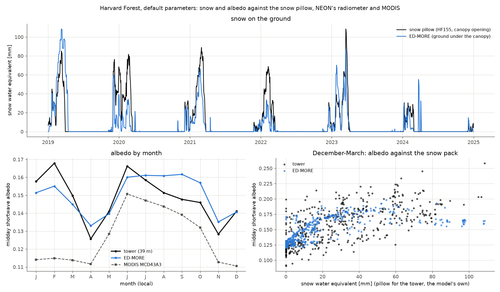

# Example 04, Harvard Forest — the column at NEON's HARV tower (prototype)

Example 04's pipeline at a second tower: a cold-deciduous and conifer forest in Massachusetts, NEON's
HARV tower (AmeriFlux US-xHA, 39 m), 2019–2024. As at BCI, the forcing is the tower's own meteorology,
the stand is the ForestGEO census around the tower, and the runs are compared with the tower's fluxes.
**Status: prototype, calibrated.** The results below are the default and the calibrated parameters.

## Run

```bash
cd examples/example04_column_biophysics/sites/harvard
python run_site.py --data <harvard data> --ameriflux AMF_US-xHA_FLUXNET_2019-2024_v1.3_r1.zip
python run_site.py ... --forcing-only          # the tower file and the forcing only
python run_site.py ... --calibrate --workers 40
```

`<harvard data>` is example 07's data folder (its `fetch_data.py`), with NEON's weighing gauge
(DP1.00044.001) and soil megapit (DP1.00096.001) in `neon/`, and in `modis/` MODIS MCD15A3H (leaf area)
for 2019–2024 and NASA AppEEARS's MCD43A3 extract (albedo, `mcd43a3_appeears/`). The FLUXNET zip comes from AmeriFlux with an account. Six years take about 6 minutes on 8
threads with the dev build. After the calibrated run, `run_site.py` draws the leaf area, the snow and
albedo, and the ten-day window (below).

## The data

| Input | Source |
|---|---|
| Meteorology and fluxes | AmeriFlux US-xHA FLUXNET (ONEFlux v1.3_r1), CC-BY-4.0. Measured values only: [`prepare_tower.py`](prepare_tower.py) blanks the product's MDS and ERA5 fills, so [`make_tower_forcing.py`](../../../../scripts/prepare_input/flux_tower/make_tower_forcing.py) fills the gaps by its own rules |
| Precipitation | NEON's weighing gauge (DP1.00044.001, Belfort AEPG II in a double fence, 1.5 km west), split to half hours by the tower bucket's timing. The tower's tipping bucket misses snow (389 against 1,246 mm below 0 °C) and stands in only for the gauge's snow-free outages |
| Stand | ForestGEO 35-ha plot (HF253), census 2 (2018–19): the 161 cells within 200 m of the tower, 6.4 ha, 12,075 stems, 41.6 m² ha⁻¹; broadleaves 74 % of the basal area ([`harvard_census.toml`](harvard_census.toml)) |
| Traits | wood density (Global Wood Density Database), sun-leaf mass per area (NEON DP1.10026.001), the soil column (NEON megapit): [`harvard_traits.py`](harvard_traits.py) |
| Leaf area | MODIS MCD15A3H (4-day, 500 m, the ORNL DAAC subset), and the LAI-2000 surveys of the 33 plots around the EMS tower, 1 km away (Harvard Forest HF069, CC0) |

## The model

- **Two PFTs** ([`pft_parameters.toml`](pft_parameters.toml)): a cold-deciduous broadleaf and an evergreen
  conifer, their phenology fitted with each cohort's own cues (Phenology, below). Example 07's Harvard allometry and foliage optics. The stand
  starts at LAI 3.9 (broadleaf, in leaf) + 1.8 (conifer) and 14.7 kgC m⁻² aboveground.
- **Both PFTs' capacities fall away near freezing**, by every PFT's low-temperature limit at its default
  (ED2's 4.7 °C; [`leaf_gas_exchange.md`](../../../../docs/science/leaf_gas_exchange.md) eq. (3b)).
- **The soil** ([`ed_config_eval.toml`](ed_config_eval.toml)): 1.09 m of stony sandy loam above the dense till,
  one van Genuchten curve from the megapit's horizons by the model's texture formulas.
- **CO₂** is held at 418 µmol mol⁻¹: the repository's CO₂ file ends in 2022.
- **The stand is frozen** (`[demography].demography_on = false`, [`ed_config_eval.toml`](ed_config_eval.toml)):
  every cohort keeps the census's size and number, while the leaves follow the season. 2019 takes the
  canopy from the census's full leaf (in January) to its season; the scoring starts in 2020.

## Phenology

Both PFTs' phenology is fitted in [example 02, part 2](../../../example02_canopy_phenology/README.md#part-2--fitting-a-stand-harvard-forest)
on this stand, with every cohort reading its own cues: the canopy air around it and the hours of light
at its top. The broadleaves follow HF003's tagged trees, canopy and understorey; the conifers keep two
thirds of their needles from October to June and grow new shoots in June. [`pft_parameters.toml`](pft_parameters.toml)
carries the fitted values.

## Results


Means over the tower's measured hours, 2020–2024, with the default parameters ([`plot_evaluation.py`](plot_evaluation.py);
the calibrated run is in [The calibration](#the-calibration)). 2019 is not scored: it takes the canopy
from the census's full leaf in January to its own season. Every mean is made from each calendar month's
hours of the day averaged over the years, so that every hour weighs the same: the tower keeps NEE and
GPP for about a fifth of the hours, few of them calm nights, and a plain mean over them would be mostly
a mean of days.

| | tower | ED-MORE | bias in June–August | bias in December–February |
|---|---|---|---|---|
| GPP [µmol m⁻² s⁻¹] | 4.56 | 5.07 | +0.05 | +0.15 |
| NEE [µmol m⁻² s⁻¹] | −1.33 | −2.80 | −1.18 | −0.78 |
| LE [W m⁻²] | 41.1 | 52.0 | +13.4 | +14.2 |
| H [W m⁻²] | 23.7 | 43.6 | +40.8 | +5.0 |
| net radiation [W m⁻²] | 87.3 | 87.6 | −2.5 | +3.6 |

- **Summer:** GPP's diurnal cycle and its June–August level match (bias +0.05 µmol m⁻² s⁻¹), and net
  radiation is within 2.5 W m⁻². The model's sink is the larger (NEE −1.18 µmol m⁻² s⁻¹ in June–August),
  mostly at night. The tower closes its energy balance to 0.76, and the calibration's attribution test
  gives the gap to H (H/Rnet rises 77 % from calm to turbulent hours, LE/Rnet does not), as at BCI: most
  of the model's higher summer H is that gap.
- **Winter and spring: the conifers.** While the broadleaves are bare, the tower sees the conifers alone,
  at two thirds of their needles from October to June (Phenology) and with every PFT's low-temperature
  limit. In the hours the tower measured with incoming shortwave above 300 W m⁻²:

  | GPP [µmol m⁻² s⁻¹] | Jan | Feb | Mar | Apr | Nov | Dec |
  |---|---|---|---|---|---|---|
  | tower | −0.07 | −0.07 | 0.43 | 1.60 | 1.50 | 0.21 |
  | ED-MORE | 0.18 | 0.63 | 1.58 | 3.70 | 4.29 | 0.56 |
  | ED-MORE calibrated | 0.16 | 0.44 | 0.94 | 1.97 | 3.32 | 0.42 |

  The tower measures no photosynthesis in January and February, not even at midday: its NEE stays a
  flat +0.87 µmol m⁻² s⁻¹ in December–February, the model's +0.09. April's and November's conifers keep
  2.3 and 2.9 times the tower's GPP, and March–May's NEE is −2.6 µmol m⁻² s⁻¹ against −0.18 at the tower.
  The calibration fits the conifers' capacity on April windows, and brings April's GPP to 1.2 times the
  tower's (The calibration).
- **Soil water.** At 15–60 cm NEON's sensors (DP1.00094.001) read 0.12–0.14 m³ m⁻³ in summer. A sealed
  base instead of the free-draining one holds twice the water and raises LE by 17 W m⁻²: the
  free-draining base is the one to keep. In a dry summer the column runs out of water long before the
  forest does ([Ten days inside the column](#ten-days-inside-the-column)).
- **Reading the tower's curves** (the grey band: the tower's mean ±2 standard errors). An hour of the
  diurnal cycle averages only the half hours ONEFlux marks as measured, and it keeps one only when u\*
  passes its threshold (0.37–0.44 m s⁻¹ here). Each summer night-time hour averages 31–55 hours from five
  summers, against 174 at midday, with a standard error of 0.3–0.7 µmol m⁻² s⁻¹: the steps between
  neighbouring night-time hours are that sampling. In winter each hour holds 98–135 hours, but the panel
  spans only 0.35 µmol m⁻² s⁻¹. The model's lines are smooth because they have no measurement noise.
  What is not sampling: on the summer nights the tower measured (21–04 h), its NEE is 5.83 against the
  model's 4.61.

## Leaf area


[`plot_lai.py`](plot_lai.py) sets the calibrated run's leaf area by PFT against MODIS (the median of the
3 × 3 500 m pixels around the tower, good retrievals only) and the LAI-2000 surveys around the EMS tower,
which read the whole canopy and its deciduous part (the leaf-off reading subtracted).
- **The summer canopy:** LAI 5.7 in July–August (broadleaves 3.9, conifers 1.7), against 4.6 from the
  surveys (deciduous part 3.05) and 4.5 from MODIS. The surveys see stems too and do not correct for
  clumping, so their level is a bound, their timing the reference.
- **Leaf-out** (halfway from leaf-off to summer) comes within 4 days of the surveys' in 2021–2024, and 9
  days after it in 2020, the spring NEON's tower measured almost nothing and the forcing is filled.
  **Leaf fall** comes within 3 days of it in three of the five years, and 7 and 12 days after it in 2024
  and 2022; in 2022, the drought year, the surveys' canopy fell early, and the model's phenology has no
  water cue.
- **The conifers** keep 1.2 in January–March, two thirds of their summer 1.7, against the surveys'
  leaf-off reading of 1.66 (stems included). MODIS reads 0.74, under snow and a low sun.
- **2019** is the spin-up: the stand starts on 2 January from the census in full leaf, and its broadleaves
  keep those leaves until the autumn (the shed side counts cold only from midsummer).

## The calibration


[`calibration.toml`](calibration.toml) fits the fast parameters with
[`scripts/calibrate_fast`](../../../../scripts/calibrate_fast/README.md), as at BCI, from the default
parameters above, for both PFTs (`[fit].pfts`: the conifers' keys are `vcmax25_pft2`, ...).
Harvard's choices and what the rules made of them:
- **Chains with the season.** The stand is frozen, so each window's state chain runs the phenology: a
  year of it (`chain_lead_days = 365`), from the census's full leaf to the window's own canopy. The
  windows therefore start in 2020.
- **Windows in both seasons**, as at BCI over its year (`[windows].months = [4, 6, 7, 8, 9]`). April is the
  off-season month the broadleaves are bare and the tower sees the conifers alone without snow; June to
  September the full canopy. Four calibration windows (3 April 2021; 10 June and 11 July 2024; 13
  September 2020) and four validation windows (20 April 2022; 15 June 2021; 4 August 2023; 3 September
  2021), at a coverage of 0.4: HARV's tower measures fewer hours than BCI's. The rule leaves out 3–9
  April 2024 (`[windows].exclude`), when the model makes a snow pack the pillow never saw. December to
  March (snow most days), May and October (the broadleaves' flush and fall) and November (their last
  leaves still at full capacity) are not used. No year's water deficit qualifies for a seasonal run, so
  the drought keys are fixed.
- **The energy-balance gap goes to H**: the tower closes to 0.76, and H/Rnet rises 77 % from the calmest
  to the most turbulent hours while LE/Rnet does not.
- **Both PFTs' capacities.** In summer the tower barely tells them apart (a summer-only fit found them
  correlated at −0.97); with the April windows they separate (|r| < 0.3). The conifers' `vcmax25` takes
  Kattge et al.'s (2009) evergreen coniferous 58 as its prior, and April takes it to 19.6. Their cold
  limit (`capacity_low_temp_pft2`, the leaf temperature that halves their capacity) stays where it
  starts, uninformed: April's GPP is low at all its temperatures, so the fit lowers the capacity, not
  the cold limit. The one capacity serves April and the summer alike; whether the conifers' summer
  capacity is that low, or higher with a cold-season course the instantaneous limit cannot give, this
  tower cannot tell. The conifers' leaf angle was screened out (uninformed).

| key | calibrated (68 % range) | prior centre |
|---|---|---|
| `vcmax25` [µmol m⁻² s⁻¹] | 67.4 (64.0–70.9) | 74.0 (from the climate) |
| `vcmax25_pft2` [µmol m⁻² s⁻¹] | 19.6 (17.6–22.3) | 58 (Kattge et al. 2009 for evergreen conifers, as BETHY uses it: Rogers 2014, Table 1) |
| `capacity_low_temp_pft2` [°C] | 1.6 (0.4–4.1: uninformed) | 4.7 (ED2's) |
| `stomatal_g1` [kPa^0.5] | 5.70 (5.26–6.16) | 1.99 (from the climate; Lin et al. 2015 give deciduous trees 4.45) |
| `stomatal_g1_pft2` [kPa^0.5] | 2.07 (1.45–3.03) | 1.99 (Lin et al. 2015 give needleleaf trees 2.35) |
| `stomatal_g0`, `stomatal_g0_pft2` [mol m⁻² s⁻¹] | 0.0029, 0.0081 (each within a factor 2.5–3) | 0.01 |
| `leaf_angle_mean` [°] | 31.8 (24.1–41.2) | 33.9 (example 07's fit) |
| `z0m_ratio` | 0.064 (0.060–0.068) | 0.13 |
| κ | 0.924 (0.885–0.965) | 1 |

Both PFTs' Jmax/Vcmax ratio is Kattge & Knorr's 1.93 for the growth temperature. On the validation
windows (RMSE in units of each target's error), default → calibrated: u\* 1.07 → 0.58, GPP 3.09 → 2.08,
LE 2.41 → 2.41, upwelling longwave 1.66 → 1.69, H 3.51 → 3.81. **The validation passes**: no target does
more than 10 % worse. The energy-balance gap is the largest uncertainty: sharing it between H and LE
instead moves `stomatal_g1` to 10.1 (the conifers' to 4.5), and the tower's daytime partitioning moves
`vcmax25` to 60 and the conifers' to 16.7. The fit took 444 trials, 15 minutes on one 40-core node.

Over 2020–2024 the calibrated run lowers GPP to 4.89 µmol m⁻² s⁻¹ (LE 50.4, H 44.9 W m⁻²) and the hourly
errors (RMSE: GPP 3.74 → 3.40, LE 49.1 → 48.2, H 59.3 → 55.3). The conifers' spring comes closest to the
tower: in the sunny hours of April their GPP is 1.97 µmol m⁻² s⁻¹ against the tower's 1.60 (the default
3.70), and March–May's NEE −2.2 against −0.18 (the default −2.6). The calibrated configs, the fit and
its report are in [`calibration/`](calibration).

## Ten days inside the column


The example runs the calibrated model to 28 August 2022, then restarts it for ten days with every
patch's and cohort's states written each half hour ([`output_window.toml`](output_window.toml)). These
are the last days of the 2022 drought, the six years' deepest water deficit: eight bright days with
showers of 5.5 mm (31 August) and 2.7 mm (4 September), then 97 mm on 5–6 September. The figure shows the
largest patch holding both PFTs (7.5 % of the site, LAI 6.3) and each PFT's tallest cohort, a 24 m
broadleaf and a 24 m conifer.
- **The column is dry to the bottom.** All three layers drawn sit at the soil's residual water
  (0.085 m³ m⁻³) until the storm. The top broadleaf's leaf water potential falls to −3.9 MPa and the
  conifer's to −4.7, and neither assimilates at midday on 28–30 August. The 5.5 mm shower on 31 August
  wets only the top 2.5 cm, yet the broadleaf recovers by 1.4 MPa and the conifer by 2.6: near its
  residual water the soil's water potential rises steeply with any water.
- **The forest is not.** On 28–30 August, between 10 and 15 h, the tower's LE averages 200 W m⁻² and its
  GPP 24 µmol m⁻² s⁻¹; the model's, on the same hours, 37 and 4.3. After the storm the model overshoots:
  LE 292 against 211 on 8–10 September. The 1.09 m free-draining column holds too little water for an
  August, or the trees reach water below it (Open).
- **Temperatures.** Only the air at 38.5 m is forcing. On the bright days the top broadleaf's leaves run
  4.5 K above it at midday and the conifer's 2.5 K; in the storm both fall to the air's temperature.
- **Canopy-air CO₂** builds up to 427 µmol mol⁻¹ on the night of 4–5 September and falls to 407 at
  midday on 6 September, when the rewetted canopy assimilates fastest (the top broadleaf 6.5 µmol m⁻² s⁻¹,
  the conifer 2.8).
- NEON's soil sensors are not drawn: in these days 26 of their 28 plot-depths fail the quality flag
  for more than a tenth of the time, and the rest read 0.01–0.03 m³ m⁻³, under any soil's residual
  water (NEON's expanded uncertainty on them is about ±0.2 m³ m⁻³).

## Snow and albedo



[`plot_snow_albedo.py`](plot_snow_albedo.py) sets the model's snow pack against the Harvard Forest snow
pillow (HF155, in a 15 m canopy opening 1.2 km west of the tower, cut so that branches do not intercept
the snow), and its midday albedo (10–14 h, shortwave above 200 W m⁻²) against the tower's radiometer and
MODIS's shortwave albedo (MCD43A3 from NASA's AppEEARS, the mean of black and white sky, the 3 × 3 500 m
pixels around the tower, full inversions only).

| winter (Nov–Apr) | 2019 | 2020 | 2021 | 2022 | 2023 | 2024 |
|---|---|---|---|---|---|---|
| peak SWE [mm], pillow / model | 85 / 109 | 82 / 60 | 89 / 67 | 69 / 34 | 109 / 87 | 31 / 55 |
| days with ≥ 5 mm, pillow / model | 88 / 97 | 100 / 74 | 102 / 93 | 83 / 65 | 94 / 91 | 52 / 38 |

- **The pack comes and goes on the right days.** It is shallower than the pillow's in 2020–2023 and
  shorter-lived in 2020 and 2022: the model melts more of it in the mid-winter thaws. Its peak is the
  higher in 2019 and 2024; on 3–4 April 2024 it turned 46 mm of precipitation near 0 °C into a pack the
  pillow never saw.
- **Albedo, leaf-on:** 0.161 in June–August against the tower's 0.159. From August the tower's falls as
  the leaves age (0.146–0.151 in August–October); the model's leaf optics do not change (0.157–0.162).
- **Albedo, bare and snow-free:** the leafless canopy is too bright, 0.132 against 0.125 in December–March,
  0.133 against 0.126 in April and 0.135 against 0.128 in November.
- **Albedo, snow:** with snow on the ground the tower reads 0.165, the model 0.154: its albedo rises less
  with the pack. The snow ED-MORE does not hold in the crowns is the likely reason: the model's snow lies
  only under them.
- **MODIS** reads lower than both all year: 0.15 in June–July and 0.11 from November to April, snow
  included. Its 500 m pixels take in clearings, roads and the tower's surroundings, and its value is a
  local-noon albedo modelled from a 16-day window, not a midday measurement.

## Open

- **The conifers' capacity across the seasons:** fitted on April windows, their `vcmax25` is 19.6, a
  third of Kattge et al.'s evergreen-conifer value, and the same value serves the summer, where the tower
  cannot tell it apart. A conifer whose capacity recovers by summer needs a cold-season course the
  instantaneous low-temperature limit cannot give (fitted, the limit stays uninformed).
- **November:** the broadleaves' last leaves keep their full capacity until they fall, and the calibrated
  model's GPP in November's sunny hours is 2.2 times the tower's.
- **Spring:** March–May's NEE is −2.2 µmol m⁻² s⁻¹ (calibrated) against the tower's −0.18: the model's
  respiration in spring, or a capacity that recovers with a lag.
- **Snow in the crowns:** the winter albedo's response to snow, and snow's interception and sublimation.
  The pack melts more in the mid-winter thaws than the pillow's.
- **The leafless canopy's brightness** and **autumn's leaf optics** (albedo above).
- **Late summer:** H stays high in August–October beyond the closure gap, and GPP falls below the tower's
  in August. In August 2022 the column dried to its residual water while the tower's LE and GPP stayed
  near their summer level (above): the soil's depth and curve, and the roots' reach into the till, are
  the suspects. The calibration's drought keys are fixed (no seasonal run qualifies).
- **Drought and the leaves:** in 2022 the surveys' canopy fell 12 days before the model's. The
  broadleaves' phenology has no water cue.
- **The night-time respiration:** on the measured summer nights the model's NEE is 21 % below the
  tower's (4.61 against 5.83 µmol m⁻² s⁻¹), and in winter its NEE is a tenth of the tower's.
- **The conifers' phenology** rests on climatologies (HF003 to 2001, the EMS baskets to 2015), and the
  depth of their winter dip on their needles' lifespan, not on a measurement.
- **Soil water to score against:** the tower's FLUXNET soil water (`SWC_F_MDS`) is almost all gap-filled,
  and NEON's own sensors pass their quality flag only part of the time (in August 2022, 2 of 28
  plot-depths for 90 % of the days) and read under any residual water when dry.
