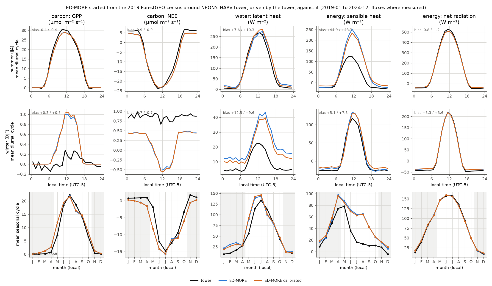

# Example 04, Harvard Forest — the column at NEON's HARV tower (prototype)

Example 04's pipeline at a second tower: a cold-deciduous and conifer forest in Massachusetts, NEON's
HARV tower (AmeriFlux US-xHA, 39 m), 2019–2024. As at BCI, the forcing is the tower's own meteorology,
the stand is the ForestGEO census around the tower, and the runs are compared with the tower's fluxes.
**Status: prototype, calibrated.** The results below are the default and the calibrated parameters.

## Run

```bash
cd examples/example04_column_biophysics/sites/harvard
python run_site.py --data <harvard data> --ameriflux AMF_US-xHA_FLUXNET_2019-2024_v1.3_r1.zip
python run_site.py ... --forcing-only          # the tower file and the forcing only
python run_site.py ... --calibrate --workers 40
```

`<harvard data>` is example 07's data folder (its `fetch_data.py`), with NEON's weighing gauge
(DP1.00044.001) and soil megapit (DP1.00096.001) in `neon/`. The FLUXNET zip comes from AmeriFlux with an
account. Six years take about 6 minutes on 8 threads with the dev build.

## The data

| Input | Source |
|---|---|
| Meteorology and fluxes | AmeriFlux US-xHA FLUXNET (ONEFlux v1.3_r1), CC-BY-4.0. Measured values only: [`prepare_tower.py`](prepare_tower.py) blanks the product's MDS and ERA5 fills, so [`make_tower_forcing.py`](../../../../scripts/prepare_input/flux_tower/make_tower_forcing.py) fills the gaps by its own rules |
| Precipitation | NEON's weighing gauge (DP1.00044.001, Belfort AEPG II in a double fence, 1.5 km west), split to half hours by the tower bucket's timing. The tower's tipping bucket misses snow (389 against 1,246 mm below 0 °C) and stands in only for the gauge's snow-free outages |
| Stand | ForestGEO 35-ha plot (HF253), census 2 (2018–19): the 161 cells within 200 m of the tower, 6.4 ha, 12,075 stems, 41.6 m² ha⁻¹; broadleaves 74 % of the basal area ([`harvard_census.toml`](harvard_census.toml)) |
| Traits | wood density (Global Wood Density Database), sun-leaf mass per area (NEON DP1.10026.001), the soil column (NEON megapit): [`harvard_traits.py`](harvard_traits.py) |

## The model

- **Two PFTs** ([`pft_parameters.toml`](pft_parameters.toml)): a cold-deciduous broadleaf (example 02's
  Harvard phenology) and an evergreen conifer. Example 07's Harvard allometry and foliage optics. The stand
  starts at LAI 3.9 (broadleaf, in leaf) + 1.8 (conifer) and 14.7 kgC m⁻² aboveground.
- **Both PFTs' capacities fall away near freezing**, by every PFT's low-temperature limit at its default
  (ED2's 4.7 °C; [`leaf_gas_exchange.md`](../../../../docs/science/leaf_gas_exchange.md) eq. (3b)).
- **The soil** ([`ed_config_eval.toml`](ed_config_eval.toml)): 1.09 m of stony sandy loam above the dense till,
  one van Genuchten curve from the megapit's horizons by the model's texture formulas.
- **CO₂** is held at 418 µmol mol⁻¹: the repository's CO₂ file ends in 2022.

## Results



Means over the tower's measured hours, 2019–2024, with the default parameters ([`plot_evaluation.py`](plot_evaluation.py);
the calibrated run is in [The calibration](#the-calibration)):

| | tower | ED-MORE | bias in June–August | bias in December–February |
|---|---|---|---|---|
| GPP [µmol m⁻² s⁻¹] | 6.60 | 7.53 | −0.37 | +0.26 |
| NEE [µmol m⁻² s⁻¹] | −3.38 | −5.24 | −0.90 | −0.70 |
| LE [W m⁻²] | 53.7 | 63.2 | +7.7 | +12.5 |
| H [W m⁻²] | 26.3 | 46.0 | +44.9 | +5.1 |
| net radiation [W m⁻²] | 86.3 | 86.9 | −0.8 | +3.3 |

- **Summer:** GPP's diurnal cycle and its July peak (22 µmol m⁻² s⁻¹) match, and net radiation is within
  1 W m⁻². The tower closes its energy balance to 0.76, and the calibration's attribution test gives the gap
  to H (H/Rnet rises 77 % from calm to turbulent hours, LE/Rnet does not), as at BCI: most of the model's
  higher summer H is that gap.
- **Winter: the conifers.** While the broadleaves are bare, the tower sees the conifers alone. Without the
  low-temperature limit they photosynthesized through the winter; with it, in sunny hours:

  | GPP [µmol m⁻² s⁻¹] | Jan | Feb | Mar | Apr | Nov | Dec |
  |---|---|---|---|---|---|---|
  | tower | 0.01 | 0.01 | 0.34 | 1.58 | 1.20 | 0.15 |
  | without the limit | 2.05 | 3.30 | 5.13 | 6.48 | 5.44 | 2.68 |
  | with it | 0.38 | 1.20 | 2.80 | 5.37 | 4.12 | 0.87 |

  December–February's NEE turns from a sink (−0.43 µmol m⁻² s⁻¹) to a source (+0.16; the tower +0.86),
  and the summer is unchanged. The tower measures no photosynthesis at all in winter, not even at midday:
  its daytime NEE stays at +0.7 to +0.95.
- **Spring is early.** April's conifers keep over three times the tower's GPP, and March–May's NEE is −3.9
  µmol m⁻² s⁻¹ against −0.2 at the tower, with May's leaf-out (GPP 18 against 11 in May).
- **Soil water.** At 15–60 cm NEON's sensors (DP1.00094.001) read 0.12–0.14 m³ m⁻³ in summer; the column
  holds 0.15–0.17. With a sealed base instead of a free-draining one it holds 0.32–0.34 and LE rises by
  17 W m⁻²: the free-draining base is the one to keep.

## The calibration

[`calibration.toml`](calibration.toml) fits the fast parameters with
[`scripts/calibrate_fast`](../../../../scripts/calibrate_fast/README.md), as at BCI, from the default
parameters above. Harvard's choices and what the rules made of them:
- **PFT 1 only**, the broadleaves (the registry's keys are one PFT's), with the deciduous-broadleaf priors;
  the conifers keep their file's values.
- **Leaf-on windows** (June–September): three calibration windows (10 June and 11 July 2024, 13 September
  2020) and one validation window (15 June 2021). No year's water deficit qualifies for a seasonal run,
  so the drought key is fixed.
- **The energy-balance gap goes to H**: the tower closes to 0.76, and H/Rnet rises 77 % from the calmest
  to the most turbulent hours while LE/Rnet does not.

| key | calibrated (68 % range) | prior centre |
|---|---|---|
| `vcmax25` [µmol m⁻² s⁻¹] | 56.2 (53.3–59.2) | 74.0 (from the climate) |
| `stomatal_g1` [kPa^0.5] | 5.34 (4.97–5.72) | 1.99 (from the climate; Lin et al. 2015 give deciduous trees 4.45) |
| `stomatal_g0` [mol m⁻² s⁻¹] | 0.0025 (0.0010–0.0065) | 0.01 |
| `leaf_angle_mean` [°] | 33.8 (26.2–42.9: the data barely constrain it) | 33.9 (example 07's fit) |
| `z0m_ratio` | 0.064 (0.060–0.069) | 0.13 |
| κ | 0.917 (0.880–0.955) | 1 |

On the validation window (RMSE in units of each target's error), default → calibrated: u\* 1.26 → 0.60,
GPP 2.64 → 2.29, LE 2.90 → 2.81, H 4.61 → 4.94, upwelling longwave 1.79 → 1.94. **The validation
passes**: no target does more than 10 % worse. The energy-balance gap is the largest uncertainty again:
sharing it between H and LE instead moves `stomatal_g1` to 10.5, and the tower's daytime partitioning
moves `vcmax25` to 48. The fit took 257 trials, 8 minutes on 200 cores of five nodes.

Over the six years the calibrated run changes the means little (GPP 7.55, LE 63.4, H 46.4) and the hourly
errors more (RMSE: GPP 4.19 → 4.07, LE 49.9 → 48.4, H 59.5 → 55.4): what is left is the winter, the
spring and the conifers, outside the fit's windows and keys. The calibrated configs, the fit and its
report are in [`calibration/`](calibration).

### Snow and albedo


[`plot_snow_albedo.py`](plot_snow_albedo.py) sets the model's snow pack against the Harvard Forest snow
pillow (HF155, in a 15 m canopy opening 1.2 km west of the tower, cut so that branches do not intercept
the snow), and its midday albedo (10–14 h, shortwave above 200 W m⁻²) against the tower's radiometer.

| winter (Nov–Apr) | 2019 | 2020 | 2021 | 2022 | 2023 | 2024 |
|---|---|---|---|---|---|---|
| peak SWE [mm], pillow / model | 85 / 108 | 82 / 60 | 89 / 73 | 69 / 37 | 109 / 100 | 31 / 55 |
| days with ≥ 5 mm, pillow / model | 88 / 97 | 100 / 105 | 102 / 98 | 83 / 72 | 94 / 105 | 52 / 60 |

- **The pack comes and goes on the right days**, and lasts about as many days. Its depth is right within
  about a third: in 2020–2022 the model melts more of it in the mid-winter thaws, and in 2019 and 2024 it
  holds more. On 3–4 April 2024 it turned 46 mm of precipitation near 0 °C into a 33 mm pack the pillow
  never saw.
- **Albedo, leaf-on:** 0.161 in June–August against the tower's 0.159. From August the tower's falls as
  the leaves age (0.146–0.151 in August–October); the model's leaf optics do not change (0.156–0.162).
- **Albedo, bare and snow-free:** the leafless canopy is too bright, 0.141 against 0.125 in December–March,
  0.140 against 0.126 in April and 0.141 against 0.128 in November.
- **Albedo, snow:** the tower's rises from 0.125 to 0.181 as the pillow's pack passes 40 mm; the model's
  from 0.141 to 0.163, under half the rise. The snow ED-MORE does not hold in the crowns is the likely
  reason: the model's snow lies only under them.

## Open

- **Spring** (above): the conifers' April capacity, the broadleaves' leaf-out, and a lag the instantaneous
  low-temperature limit does not have.
- **Snow in the crowns:** the winter albedo's response to snow, and snow's interception and sublimation.
- **The leafless canopy's brightness** and **autumn's leaf optics** (albedo above).
- **Late summer:** H stays high in August–October beyond the closure gap, and GPP falls below the tower's
  in August, with the soil water at NEON's level: the stress on the column's sandy curve is the suspect.
- **The calibration** fits PFT 1's keys only, on three calibration windows and one validation window.
- **The start:** the stand starts on 2 January 2019 from the census in full leaf, and the broadleaves keep
  those leaves until the summer (the shed side counts cold only from midsummer), so January–May 2019 has
  a leafy canopy. Without that spring, March's and April's conifer GPP is 2.2 and 5.1 µmol m⁻² s⁻¹, not 2.8
  and 5.4.
- **MODIS albedo** (MCD43A3) joins the albedo panel once NASA's AppEEARS request completes.
- The tower's FLUXNET soil water (`SWC_F_MDS`) is almost all gap-filled; NEON's own soil sensors are the
  ones to score against.
