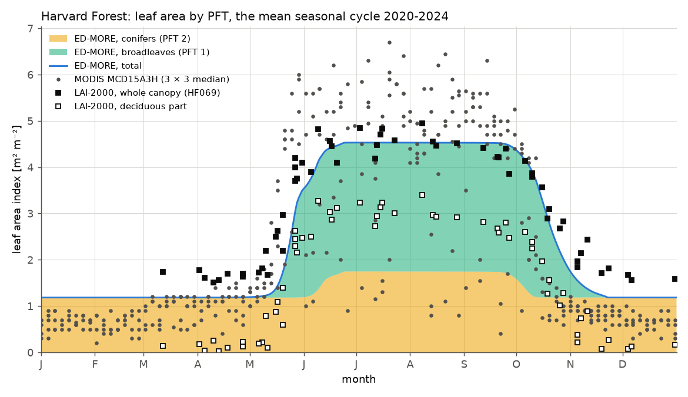

# Example 04, Harvard Forest — the column at NEON's HARV tower (prototype)

Example 04's pipeline at a second tower: a temperate broadleaf and conifer forest in Massachusetts,
NEON's HARV tower (AmeriFlux US-xHA, 39 m), 2019–2024. As at BCI, the forcing is the tower's own
meteorology, the stand is the ForestGEO census around the tower, and the runs are compared with the
tower's fluxes. **Status: prototype.**

The example:

1. builds the forcing from the tower's meteorology and NEON's precipitation gauge;
2. starts a frozen stand from the 2019 census, its leaves following the phenology fitted in example 02;
3. calibrates the fast parameters of both PFTs against the tower;
4. compares the default and the calibrated runs with the tower's fluxes, the leaf area, the snow and
   the albedo;
5. reruns ten days of the 2022 drought at half-hourly output.

## Run

```bash
cd examples/example04_column_biophysics/sites/harvard
python run_site.py --data <harvard data> --ameriflux AMF_US-xHA_FLUXNET_2019-2024_v1.3_r1.zip
python run_site.py ... --forcing-only          # the tower file and the forcing only
python run_site.py ... --calibrate --workers 40
```

`<harvard data>` is example 07's data folder (its `fetch_data.py`), with NEON's weighing gauge
(DP1.00044.001) and soil megapit (DP1.00096.001) in `neon/`, and MODIS leaf area (MCD15A3H) and NASA
AppEEARS's MCD43A3 albedo extract (`mcd43a3_appeears/`) in `modis/`. The FLUXNET zip needs an
AmeriFlux account. Six years take about 7 minutes on 8 threads with the dev build; with `--calibrate`,
every step takes 62 minutes on one 40-core node.

## The data

| Input | Source |
|---|---|
| Meteorology and fluxes | AmeriFlux US-xHA FLUXNET (ONEFlux v1.3_r1), CC-BY-4.0. Measured values only: [`prepare_tower.py`](prepare_tower.py) blanks the product's fills, and [`make_tower_forcing.py`](../../../../scripts/prepare_input/flux_tower/make_tower_forcing.py) fills the gaps by its own rules |
| Precipitation | NEON's weighing gauge (DP1.00044.001, 1.5 km west), split to half hours by the tower bucket's timing. The tower's tipping bucket misses snow (389 against 1,246 mm below 0 °C) and stands in only for the gauge's snow-free outages |
| Stand | ForestGEO 35-ha plot (HF253), census 2 (2018–19): the 161 cells within 200 m of the tower, 6.4 ha, 10,014 trees (12,075 stems, lumped per tree), 41.6 m² ha⁻¹; broadleaves 74 % of the basal area ([`harvard_census.toml`](harvard_census.toml)) |
| Traits | wood density (Global Wood Density Database), sun-leaf mass per area (NEON DP1.10026.001), the soil column (NEON megapit): [`harvard_traits.py`](harvard_traits.py) |
| Leaf area | MODIS MCD15A3H (4-day, 500 m), and the LAI-2000 surveys of the 33 plots around the EMS tower, 1 km away (Harvard Forest HF069, CC0) |

## 1. The model

[`ed_config_eval.toml`](ed_config_eval.toml) runs 2019–2024; the scoring starts in 2020.
- **The stand is the 2019 census, frozen** (`demography_on = false`): every cohort keeps its size and
  number, and only the leaves change. It starts at LAI 2.8 (broadleaf, in leaf) + 1.8 (conifer) and
  15.0 kgC m⁻² aboveground; 2019 takes the canopy from the census's full leaf to its own season.
- **Two PFTs** ([`pft_parameters.toml`](pft_parameters.toml)): a cold-deciduous broadleaf and an
  evergreen conifer, with example 07's Harvard allometry and foliage optics. The broadleaves' leaf area
  is scaled so that the summer canopy is the mean of MODIS and the LAI-2000 surveys. Both PFTs'
  capacities fall away near freezing (ED2's low-temperature limit).
- **The phenology** is fitted in [example 02, part 2](../../../example02_canopy_phenology/README.md#part-2--fitting-a-stand-harvard-forest)
  on this stand, every cohort reading the canopy air around it and the light at its top. The
  broadleaves follow HF003's tagged trees; the conifers keep two thirds of their needles from October to
  June and grow new shoots in June.
- **The soil** is 1.5 m of stony sandy loam: the NEON megapit's 1.09 m above a dense till, and 0.4 m
  of the till's top, which the trees draw on in a dry August. One van Genuchten curve from the megapit's
  horizons; the base drains freely.
- **CO₂** is held at 418 µmol mol⁻¹ (the repository's CO₂ file ends in 2022).

## 2. The calibration


[`calibration.toml`](calibration.toml) fits the fast parameters of both PFTs with
[`scripts/calibrate_fast`](../../../../scripts/calibrate_fast/README.md). Harvard's choices:
- **Windows in two seasons:** April, when the broadleaves are bare and the tower sees the conifers
  alone, and June–September, the full canopy. Four calibration and four validation windows, at a
  coverage of 0.4 (HARV's tower measures fewer hours than BCI's). The rule leaves out 3–9 April 2024,
  when the model makes a snow pack the snow pillow never saw.
- **Chains with the season:** the stand is frozen, so each window's chain runs a year of phenology to
  bring the canopy to the window's season (`chain_lead_days = 365`).
- **One seasonal run, 2022's drought:** 90 days to its deepest water deficit (412 mm on 4 September),
  scored on LE. Its LE does not inform the water-stress keys: with 1.5 m of soil the stand transpires
  through the drought, so they keep the PFT file's value.
- **κ and the energy-balance gap, as at BCI:** the tower closes to 0.76, and the gap goes to H (H/Rnet
  rises 77 % from calm to turbulent hours, LE/Rnet does not).
- **The conifers' capacity** has a needleleaf prior (Kattge et al. 2009) and is set by the April
  windows, which tell the two PFTs apart.

| key | calibrated (68 % range) | prior centre |
|---|---|---|
| `vcmax25` [µmol m⁻² s⁻¹] | 90.8 (86.0–95.5) | 74.0 (from the climate) |
| `vcmax25_pft2` [µmol m⁻² s⁻¹] | 20.5 (18.2–23.4) | 58 (Kattge et al. 2009, evergreen conifers) |
| `capacity_low_temp_pft2` [°C] | 4.8 (2.6–7.6) | 4.7 (ED2's) |
| `stomatal_g1`, `stomatal_g1_pft2` [kPa^0.5] | 3.30 (3.16–3.46), 3.25 (2.61–4.04) | 1.99 (from the climate) |
| `stomatal_g0`, `stomatal_g0_pft2` [mol m⁻² s⁻¹] | 0.0012, 0.0041 (each within a factor 2.3–2.7) | 0.01 |
| `leaf_angle_mean` [°] | 32.7 (24.9–42.3) | 33.9 (example 07's fit) |
| `z0m_ratio` | 0.058 (0.055–0.062) | 0.13 |
| κ | 0.920 (0.882–0.958) | 1 |

The broadleaves' `vcmax25` is the capacity of a leaf at the canopy top. It falls with the leaf area
above, to about 66 averaged over the canopy, and it rests on the leaf area: the tower sets capacity
times leaf area. On the validation windows (RMSE in units of each target's error) the calibration
improves u\* (1.14 → 0.63), GPP (2.75 → 2.13) and LE (2.16 → 1.88), and does worse on H (3.11 → 3.23)
and the upwelling longwave (1.57 → 1.81). **The validation fails** on the longwave: 15 % worse, where
the rule allows 10 %. The fit took 753 runs, 44 minutes on one 40-core node. The calibrated configs,
the fit and its report are in [`calibration/`](calibration).

## 3. Against the tower


Means over the tower's measured hours, 2020–2024, every hour of the day weighted alike
([`evaluation.py`](../../evaluation.py)). The dashed lines and the target column are the tower as the
calibration scores it: GPP with κ, and H with the energy-balance gap.

| | tower | target | default | calibrated |
|---|---|---|---|---|
| GPP [µmol m⁻² s⁻¹] | 4.56 | 4.71 | 4.82 | 5.12 |
| LE [W m⁻²] | 41.1 | 41.1 | 52.4 | 46.3 |
| H [W m⁻²] | 25.2 | 51.3 | 46.1 | 51.1 |
| NEE [µmol m⁻² s⁻¹] | −1.33 | | −2.84 | −3.00 |
| net radiation [W m⁻²] | 87.3 | | 88.4 | 88.2 |

- **Summer (June–August):** the calibration brings LE from 13 W m⁻² above the tower to 3 above, and H
  to its target. GPP goes from 0.6 µmol m⁻² s⁻¹ below its target to 0.6 above. The model's sink is the
  larger (NEE 2.1 µmol m⁻² s⁻¹ more negative), mostly at night: on the measured summer nights its NEE is
  4.5 against the tower's 5.8.
- **Winter and spring: the conifers.** With the broadleaves bare the tower sees the conifers alone. It
  measures no photosynthesis in January and February, and its NEE stays at +0.87 µmol m⁻² s⁻¹ in
  December–February (the model's +0.13). In April's sunny hours the calibrated GPP is 2.00 against the
  tower's 1.60 (default 3.74). November's is 3.05 against 1.50: the broadleaves' last leaves keep their
  full capacity until they fall. March–May's NEE is −2.2 against the tower's −0.18.
- **Winter LE is too high on snow days.** With snow on the ground the calibrated LE is 26 W m⁻² against
  the tower's 9; on bare winter days it is 8.1 against 11.9. Nearly all of it is sublimation from the
  snow pack (0.7 mm a day), which draws heat from the canopy air. With the broadleaves bare, the open
  fraction e^−(LAI+WAI) is about 0.5 in the broadleaf cells, so the snow exchanges with the canopy air
  almost as in the open, and the open ground's conductance has no stability correction. The model's
  winter LE also peaks 2 hours after the tower's, following the snow's and the soil surface's
  temperature.
- **Soil water.** The tower's own soil water is gap-filled in every summer, and NEON's sensors read low
  and pass their quality flag on 15–60 % of the readings. Harvard Forest's TDR record near the EMS
  tower (HF006, top 15 cm, 1995–2004) gives summer means of 0.19–0.33 m³ m⁻³ and 0.06–0.07 in dry
  summers. The model's top 15 cm hold 0.21 in July–August 2021 and 0.10 at 2022's low. With the
  megapit's 1.09 m alone the column runs dry by mid-August 2022 and LE falls a third below the tower's;
  with 1.5 m the calibrated LE is 115 W m⁻² against the tower's 117 over 15–28 August.
- **Reading the tower's curves:** the grey band is the tower's mean ±2 standard errors. A summer
  night-time hour averages only 31–55 measured hours (the u\* filter keeps few calm nights), so the steps
  between neighbouring night hours are sampling noise.

## 4. Leaf area



[`plot_lai.py`](plot_lai.py) compares the calibrated run's leaf area with MODIS (the median of the
3 × 3 500 m pixels around the tower) and the LAI-2000 surveys around the EMS tower.
- **Summer:** LAI 4.5 in July–August (broadleaves 2.8, conifers 1.8), the mean of the surveys' 4.6 and
  MODIS's 4.5 by construction.
- **Leaf-out** (halfway to the summer canopy) comes within 5 days of the surveys' in 2021–2024, and 10
  days later in 2020, when the tower measured almost nothing in spring and the forcing is filled.
  **Leaf fall** comes within 3 days in three of the five years, and 8 and 12 days late in 2024 and
  2022; in 2022, the drought year, the surveys' canopy fell early, and the model's phenology has no
  water cue.
- **The conifers** keep 1.2 in January–March, against the surveys' leaf-off reading of 1.66 (stems
  included); MODIS reads 0.74, under snow and a low sun.

## 5. Snow and albedo


[`plot_snow_albedo.py`](plot_snow_albedo.py) compares the model's snow pack with the Harvard Forest
snow pillow (HF155, in a canopy opening 1.2 km west of the tower), and its midday albedo with the
tower's radiometer and MODIS (MCD43A3).

| winter (Nov–Apr) | 2019 | 2020 | 2021 | 2022 | 2023 | 2024 |
|---|---|---|---|---|---|---|
| peak SWE [mm], pillow / model | 85 / 113 | 82 / 59 | 89 / 70 | 69 / 36 | 108 / 91 | 31 / 55 |
| days with ≥ 5 mm, pillow / model | 88 / 101 | 100 / 101 | 102 / 99 | 83 / 84 | 94 / 97 | 52 / 50 |

- **The pack comes and goes on the right days** but is shallower than the pillow's in 2020–2023: the
  model melts more of it in the mid-winter thaws. On 3–4 April 2024 it made a pack the pillow never saw
  from 46 mm of precipitation near 0 °C.
- **Albedo:** in leaf, 0.156 against the tower's 0.159 in June–August, but the model's leaves do not age
  as the tower's do from August. The leafless canopy is too bright (0.131 against 0.125 in
  December–March), and too dark with snow on the ground (0.152 against 0.165): the model holds no snow
  in the crowns.
- **MODIS** reads lower all year (0.15 in summer, 0.11 in winter): its 500 m pixels take in clearings
  and roads, and its value is modelled from 16 days of retrievals.

## 6. Ten days inside the column


The example runs the calibrated model to 28 August 2022, then restarts it for ten days with every
patch's and cohort's states written each half hour ([`output_window.toml`](output_window.toml)). These
are the last days of the 2022 drought: eight bright days with showers of 5.5 mm (31 August) and 2.7 mm
(4 September), then 97 mm on 5–6 September. The figure shows the largest patch holding both PFTs (8.7 %
of the site, LAI 6.6) and each PFT's tallest cohort, both 28 m.
- **The patch's soil is not dry:** every layer down to 1.5 m holds 0.13–0.14 m³ m⁻³ on 28 August (the
  residual is 0.079), and 0.13 by 4 September. The leaves' water potential hardly moves: the broadleaf's
  falls to −0.8 to −0.9 MPa at midday and the conifer's to −0.6 to −0.7, and both refill to −0.35 each
  night; the 5.5 mm shower raises them by 0.02 MPa.
- **Both trees keep assimilating:** the broadleaf at 11–13 µmol m⁻² s⁻¹ from 10 to 15 h until 3 September,
  the conifer at 4.5. On 28–30 August, 10–15 h, the tower's LE is 200 W m⁻² and its GPP 24 µmol m⁻² s⁻¹;
  the model's 170 and 26. After the storm the model overshoots (LE 245 against 207 on 8–10 September).
- **Temperatures:** only the air at 38.5 m is forcing. At midday on the bright days the broadleaf's
  leaves run 1.6 K above it and the conifer's 1.8 K.
- **Canopy-air CO₂** rises to 426 µmol mol⁻¹ on the night after the shower and falls to 405 at midday on
  4 September.
- NEON's soil sensors are not drawn: in these days 26 of their 28 plot-depths fail the quality flag,
  and the rest read 0.01–0.03 m³ m⁻³, below any soil's residual water.

## Open

- **Snow sublimation under a leafless canopy:** the snow-to-canopy-air conductance in winter (Against
  the tower).
- **The upwelling longwave:** the validation's one failure, not yet diagnosed.
- **The conifers' capacity across the seasons:** the April windows' 20.5 serves the summer too; a
  capacity that recovers by summer needs a cold-season course the low-temperature limit cannot give.
- **November and spring:** the broadleaves' last leaves keep full capacity until they fall, and
  March–May's NEE is −2.2 against −0.18.
- **Drought:** the column's last 0.4 m is not measured, the water-stress keys stay uninformed, and the
  broadleaves' phenology has no water cue.
- **Night-time respiration:** the model's summer-night NEE is 23 % below the tower's, and its winter NEE
  a seventh of it.
- **Snow in the crowns and leaf optics:** the albedo with snow, the leafless canopy's brightness and
  autumn's leaf ageing.
- **The conifers' phenology** rests on climatologies (HF003 to 2001, HF069 to 2015).

## Files

| File | What it is |
|---|---|
| [`run_site.py`](run_site.py) | runs every step |
| [`prepare_tower.py`](prepare_tower.py), [`harvard_site.toml`](harvard_site.toml) | the tower file (measured values only) and its declaration |
| [`harvard_census.toml`](harvard_census.toml), [`harvard_traits.py`](harvard_traits.py) | the census declaration, and the traits and soil from the site's data |
| [`ed_config_eval.toml`](ed_config_eval.toml), [`pft_parameters.toml`](pft_parameters.toml), [`output_variables.toml`](output_variables.toml) | the ED-MORE run, its PFTs and its output |
| [`calibration.toml`](calibration.toml) | the calibration's Harvard choices |
| [`calibration/`](calibration) | the calibrated configs, the fit (`fit.json`) and its report |
| [`output_window.toml`](output_window.toml) | the ten-day window's output |
| [`plot_evaluation.py`](plot_evaluation.py), [`plot_lai.py`](plot_lai.py), [`plot_snow_albedo.py`](plot_snow_albedo.py), [`plot_window.py`](plot_window.py) | the figures (the readers are the example's [`evaluation.py`](../../evaluation.py)) |
