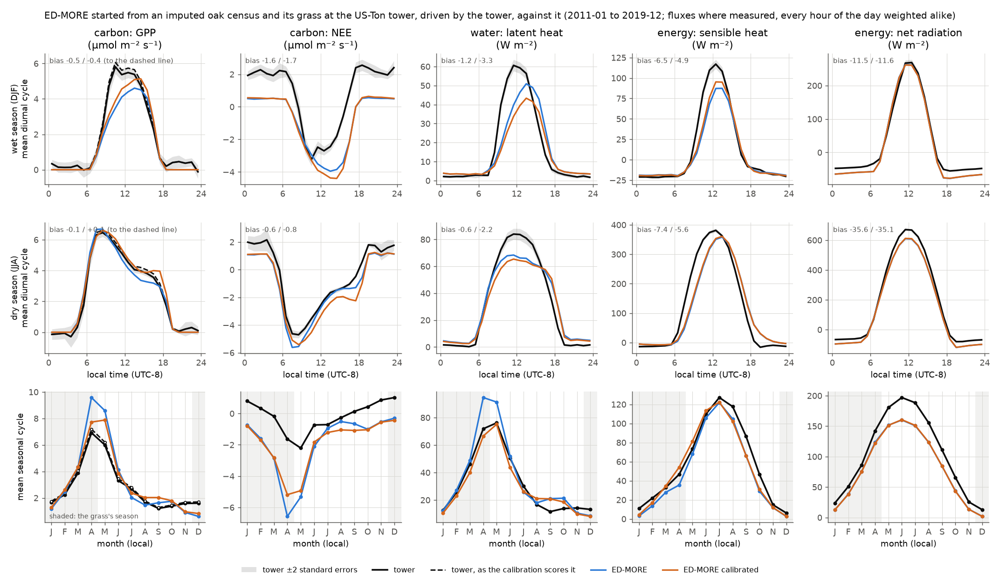
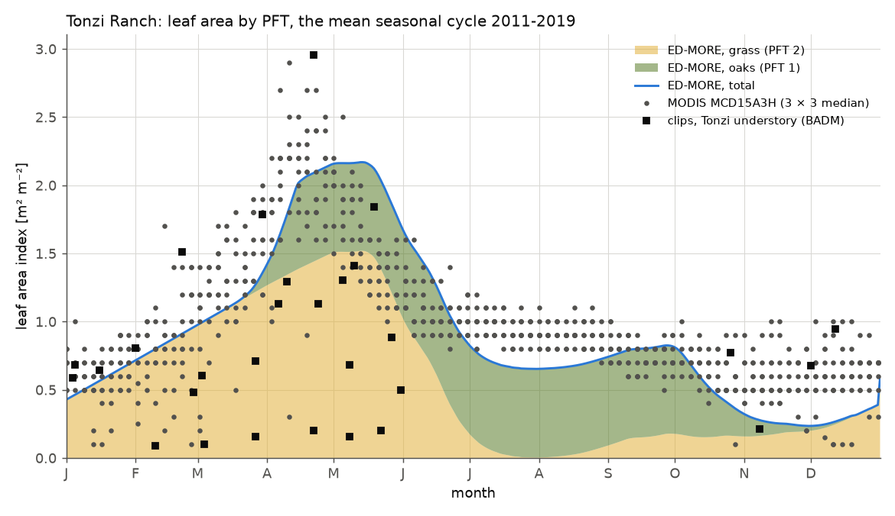

# Example 04, Tonzi Ranch — a blue-oak savanna and its grass (prototype)

The coupled column at a savanna: deciduous blue oaks over a C3 annual grass in the Sierra Nevada foothills
of California, at the AmeriFlux tower US-Ton (23.5 m), 2010–2019. It is ED-MORE's first stand with a plant
that is not a tree: the grass has no stem, stands at its plant type's height and changes only its leaf area
([`docs/science/plant_carbon_allocation.md`](../../../../docs/science/plant_carbon_allocation.md) §2).
**Status: prototype.**

The example:

1. builds the forcing from the tower's meteorology, with Vaira Ranch's where Tonzi measured nothing;
2. starts a frozen stand: oaks at the field survey's size distributions, and the grass beneath and between
   them, with the phenology fitted in example 02, part 3;
3. calibrates the fast parameters of both plant types against the tower;
4. compares the default and the calibrated runs with the tower, and the leaf area with MODIS;
5. follows ten April days hour by hour: a canopy oak, the grass beneath it and the grass in the open.

## Run

```bash
cd examples/example04_column_biophysics/sites/tonzi
python run_site.py --ameriflux AMF_US-Ton_FLUXNET_2001-2025_v1.3_r1.zip --badm <base> --modis <modis>
python run_site.py ... --forcing-only          # the tower file and the forcing only
python run_site.py ... --calibrate --workers 60
```

`<base>` holds AmeriFlux's BASE-BADM zips of US-Ton and US-Var (`AMF_US-Ton_BASE-BADM_27-5.zip`,
`AMF_US-Var_BASE-BADM_27-5.zip`); they and the FLUXNET zip need an AmeriFlux account. `<modis>` holds ORNL
DAAC's MCD15A3H subset around the tower (`us_california_tonzi_ranch_mcd15a3h_{Lai_500m,FparLai_QC}.csv`).
Every step but the calibration takes about 5 minutes on 32 cores with the dev build; with `--calibrate`,
11 minutes on 64 cores.

## The data

- **Tower:** AmeriFlux US-Ton FLUXNET (ONEFlux v1.3_r1), CC-BY-4.0, measured values only. Rain and pressure
  come from US-Ton's BASE file, and where Tonzi has none from Vaira Ranch's (US-Var, 2.4 km away);
  longwave before 2014, Tonzi's first year of it, is Vaira's less its mean excess over Tonzi's
  ([`prepare_tower.py`](prepare_tower.py)). Cite US-Ton's BASE as Ma, Xu, Verfaillie & Baldocchi,
  doi:10.17190/AMF/1245971, and US-Var's as doi:10.17190/AMF/1245984.
- **Stand:** the oaks at the field survey's size distributions, from a figure of Miriam Johnston's PhD
  dissertation: their basal area by 10 cm DBH class and the density of their DBH and height (the survey's
  gray pines left out). **Not measured trees** ([`make_tonzi_census.py`](make_tonzi_census.py)).
- **Traits:** from the site literature, each value's source in [`pft_parameters.toml`](pft_parameters.toml),
  among them the oaks' sapwood area (Miller 2009) and their leaf water potentials in the dry summers of
  2007–2008 (Osuna et al. 2015; Miller et al. 2010).
- **Leaf area and phenology:** the BADM's clip LAI and phenology dates, PhenoCam's `tonzi_GR_1000` greenness
  (example 02, part 3), and MODIS MCD15A3H (doi:10.5067/MODIS/MCD15A3H.061). The ground's albedo is set from
  MODIS MCD43A over the tower.

## 1. The model

[`ed_config_eval.toml`](ed_config_eval.toml) runs 2010–2019; the scoring starts in 2011.

- **The stand is frozen** (`demography_on = false`): only the leaves change. The census's 100 cells of
  10 m restructure to 11 patches and 84 cohorts.
  - **The oaks** are 285 stems ha⁻¹ and 10.5 m² ha⁻¹ on the 40 % of the cells they cover, each DBH class at
    the survey's basal area. Their height curve, H = 0.84 D^0.74, matches the survey's DBH and height
    distributions, up to 16.6 m; their leaf area gives the trees' LAI, 0.65.
  - **The grass** is one row per cell, 0.3 m tall, at Vaira's open-grassland peak LAI in the open (2.55)
    and the Tonzi understory's under the oaks (1.31).
- **Two plant types:** blue oak and a C3 annual grass (`growth_form = "grass"`). The phenology is fitted in
  [example 02, part 3](../../../example02_canopy_phenology/README.md#part-3--a-savanna-tonzi-ranch): the
  oaks flush on warmth and long days and drop their leaves on cold or drought; the grass grows and dies on
  water alone.
- **The oaks' water path is blue oak's:** the site's sapwood area, blue oak's pressure–volume curve
  (turgor loss at −3.3 MPa), and a leaf conductance and stomatal closure fitted to their measured midday
  leaf water potential:

  | oak leaf water potential [MPa], predawn / midday | measured | ED-MORE |
  |---|---|---|
  | May | −0.2 to −0.8 / −0.85 to −2.7 | −0.33 / −2.12 |
  | early July, dry summers | −1.3 to −2.6 / −2.9 to −4.0 | −2.85 / −4.07 |
  | late August, dry summers | −3.7 to −5.2 / −3.2 to −4.8 | −2.95 / −4.15 |

  Measured at Tonzi in 2007–2008, read off Osuna et al. (2015) and Miller et al. (2010); ED-MORE's are the
  dry summers 2012–2015, leaf-area weighted, at 4–6 h and 12–15 h.
- **The soil** is 1 m of loam over weathered rock to the water table at 9 m, which the oaks' roots reach,
  as the real oaks draw on the groundwater 7–12 m down (Miller 2009). The rock holds a fifth of the loam's
  water, a texture per layer (`[soil]`).
- **The ground's albedo** (0.08 in the visible, 0.25 in the near infrared) gives the stand MODIS's midday
  albedo, 0.14–0.16. The landscape's roughness is floored at Vaira's aerodynamic canopy height, 0.65 m.

## 2. The calibration

[`calibration.toml`](calibration.toml) fits both plant types' capacity and stomata on the grass's months
(January–February), the oaks' (July–August) and April. Three choices are Tonzi's own:

- **H and LE are scored as measured:** the tower's net radiometer and soil heat flux plates do not see the
  fluxes' footprint (Baldocchi, Xu & Kiang 2004, §2.4), so its energy-closure gap is not shared out.
- **The oaks' g1 takes the meta-analysis prior** for deciduous broadleaf trees (4.45, Lin et al. 2015), not
  the least-cost value of the site's year, whose climate includes the grass's winter.
- **The leaf angles stay at the measured** (the oaks' 63°, 1200 leaves).

It passes its own validation: on the windows it held out the cost falls by 6 % and GPP's error by two
fifths ([`calibration/report.md`](calibration/report.md)). It takes the oaks' g1 to 2.1 and their Vcmax to
58, and makes their stomata close steeply in drought: the 2014 drought windows saw the real oaks near
closure at predawn potentials the model's oaks do not reach (Limitations).

## 3. Against the tower



Means over the tower's measured hours, 2011–2019, every hour of the day weighted alike
([`plot_evaluation.py`](plot_evaluation.py)):

| | tower | default | calibrated |
|---|---|---|---|
| GPP [µmol m⁻² s⁻¹] | 2.85 | 3.22 | 3.14 |
| LE [W m⁻²] | 31.9 | 35.9 | 30.3 |
| H [W m⁻²] | 57.8 | 49.2 | 53.4 |
| net radiation [W m⁻²] | 103.3 | 81.6 | 81.4 |
| June–August LE / H bias [W m⁻²] | | −0.6 / −7.4 | −2.2 / −5.6 |

- **The grass's season is right in timing, its spring too productive.** From December to February GPP and
  LE are within 1.0 µmol m⁻² s⁻¹ and 5 W m⁻² of the tower's each month. In April and May, with the oaks
  leafing out over the grass at its peak, GPP runs 2.6–2.7 µmol m⁻² s⁻¹ and LE 15–23 W m⁻² high.
- **The oaks' summer follows the tower:** from June to August GPP is within 0.8 µmol m⁻² s⁻¹ and LE within
  5 W m⁻² each month, and the oaks close through the afternoon. In September and October LE runs 7–10 W m⁻²
  high.
- **The summer's H is short at midday,** 326 against 360 W m⁻², because the model puts 150 W m⁻² into the
  ground, where Tonzi's plates measure 41 and Vaira's open grassland 53 (Limitations). The model's net
  radiation is 36 W m⁻² below the tower's in summer, 15 of them the tower's radiometer reading above its
  own four components.

## 4. Leaf area



Each plant type's daily leaf area in the default run, the mean seasonal cycle over 2011–2019
([`plot_lai.py`](plot_lai.py)), against MODIS (the median of the 3 × 3 pixels of 500 m around the tower)
and the understory's clips, each on its day of the year.

- **The grass fills over the winter** after the first big rain and dies in May and June; its peak follows
  the year's rain, from 1.34 in 2013 to 2.04 in 2017. In March–April the stand's LAI is 1.52 against
  MODIS's 1.65.
- **The spring is about two weeks late:** the model peaks on 5 May, MODIS on 20 April, and the model's
  grass dies three weeks after MODIS's stand fades.
- **The summer and the winter are low against MODIS** by about 0.2: the oaks' 0.65 is the survey's LAI,
  and a 500 m pixel also holds standing dead grass and branches, which the retrieval does not tell from
  leaves.

## 5. Ten days inside the column


The default run to 18 April 2016, restarted for ten days with every patch's and cohort's states written
each hour ([`output_window.toml`](output_window.toml), [`plot_window.py`](plot_window.py)): four warm,
clear days, 13.5 mm of rain on the 22nd and 31 mm on the 27th. Two patches: the largest under the oaks
(8 % of the site, LAI 2.3) with its tallest oak (12 m) and the grass beneath it, and the largest in the
open (60 %, LAI 1.7).

- **The open is the warmer.** At midday on the warm days its canopy air is 2.1 °C above the forcing's air
  (0.4 under the oaks), and its soil 2.5 cm down reaches 39 °C (34 under the oaks).
- **The light sets the assimilation:** 22 µmol m⁻² s⁻¹ at midday for the canopy oak's leaves, 13 for the
  open grass's and 10 for the shaded grass's.
- **The leaves' water potential** falls each afternoon and recovers each night: −2.5 MPa for the oak, −1.4
  for the open grass on the drier topsoil, −1.1 for the shaded grass.
- **The storms wet the top 10 cm** from 0.14–0.17 to 0.30–0.37 m³ m⁻³; deeper down the soil dries through
  the ten days, faster in the open.

## Limitations

1. **The stand is not the ground census.** The oaks carry the field survey's size distributions, read off a
   figure, not its trees; its tree list would replace them. Their 2.7 kgC m⁻² above ground is below the
   BADM's 4.24.
2. **There is no dead-grass layer.** Through the summer the ground is bare soil, which takes three to four
   times the measured ground heat flux at midday and leaves H short; a mat of dead grass would insulate it
   and return the sun's heat as H, as a litter layer would on a forest floor.
3. **Vcmax does not decline over the season.** Blue oak's falls by more than 60 % through the summer (Xu &
   Baldocchi 2003; Osuna et al. 2015); the model's oaks keep their spring capacity, and the calibration
   stands in for it with a lower Vcmax and a steep drought response. A capacity that declines with leaf
   age and drought would serve deciduous and evergreen canopies alike.
4. **The drought's predawn potential is too wet.** In late summer the model's oaks sit near −3 MPa before
   dawn, against −3.7 to −5.2 MPa measured: their roots meet a water table held at 9 m, where the real
   oaks do not come to equilibrium with the groundwater (Miller 2009). The well's water table (2–9 m) as
   the column's bottom would test it.

## Files

| File | What it is |
|---|---|
| [`run_site.py`](run_site.py) | runs every step |
| [`prepare_tower.py`](prepare_tower.py), [`tonzi_site.toml`](tonzi_site.toml) | the tower file and its declaration |
| [`make_tonzi_census.py`](make_tonzi_census.py) | the oaks at the survey's distributions, the grass, and the steady litter input for the soil carbon |
| [`ed_config_eval.toml`](ed_config_eval.toml), [`pft_parameters.toml`](pft_parameters.toml), [`output_variables.toml`](output_variables.toml) | the ED-MORE run, its PFTs and its output |
| [`calibration.toml`](calibration.toml), [`calibration/`](calibration) | the calibration's Tonzi choices, the calibrated configs, the fit and its report |
| [`output_window.toml`](output_window.toml) | the ten-day window's output |
| [`plot_evaluation.py`](plot_evaluation.py), [`plot_lai.py`](plot_lai.py), [`plot_window.py`](plot_window.py) | the figures |
