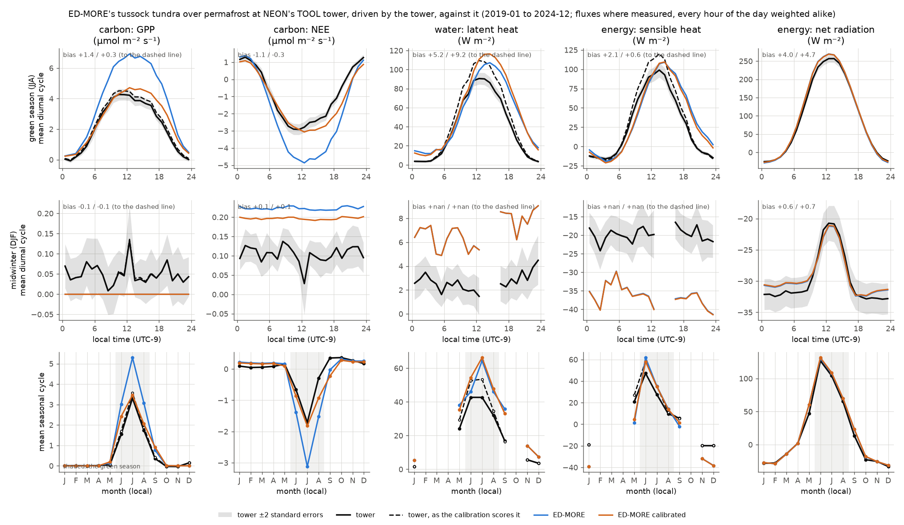
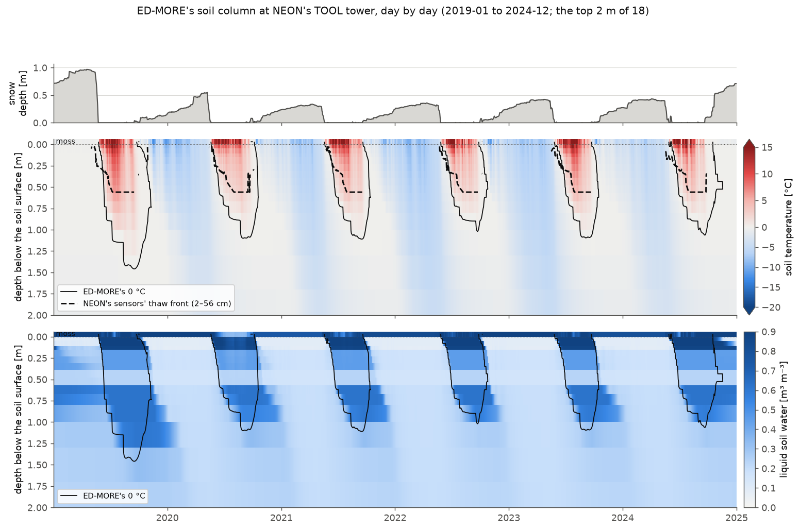

# Example 04, Toolik — tussock tundra over permafrost (prototype)

The coupled column in moist acidic tussock tundra on the northern foothills of the Brooks Range, Alaska, at
NEON's TOOL tower (AmeriFlux US-xTL, 8.9 m), 2019–2024. It is ED-MORE's first site over permafrost: an 18 m
soil column whose base is the permafrost's temperature, peat over mineral soil, a moss layer on the ground,
snow that buries the plants, and dwarf shrubs, woody plants sized by their stems' diameter at the ground.
**Status: prototype.** Its phenology is fitted in example 02's part 4 and its fast parameters by
`calibrate_fast` (section 2).

The example:

1. builds the forcing from the tower's measured meteorology, with a nearby station's humidity and
   precipitation and the FLUXNET product's ERA5 wind and pressure where the tower measured nothing;
2. builds the soil column from NEON's soil pit and Imnavait Creek's peat, and a frozen stand from the site's
   harvest and plant cover, each plant type on its own land-cover patch;
3. spins the permafrost column up for 30 years on the six tower years;
4. runs the six tower years with the default and the calibrated parameters, compares them with the tower's
   fluxes, and draws the soil column day by day, its temperature against NEON's sensors and its liquid water.

## Run

```bash
cd examples/example04_column_biophysics/sites/toolik
python run_site.py --data <toolik> --ameriflux AMF_US-xTL_FLUXNET_2019-2024_v1.3_r1.zip
python run_site.py ... --forcing-only          # the tower file and the forcing only
python run_site.py ... --calibrate --workers 40   # also redo the fast-parameter fit (section 2)
python plot_evaluation.py --calibrated "output/cal-F-*.nc"   # evaluation.png, output/evaluation_stats.json
python plot_soil.py                            # soil.png: the soil column, day by day
```

`<toolik>` holds:
- `neon/`: NEON's soil pit (DP1.00096.001), soil temperature (DP1.00041.001) and plant cover (DP1.10058.001);
- `ornl_above/`: ORNL DAAC's Imnavait soil pits (`Arctic_Soil_Properties`, dataset 2149) and the Toolik
  Lake vegetation plots (`Toolik_Lake_Veg_Plots`, dataset 1333);
- `arc_lter/`: the ARC LTER MAT06 harvest (knb-lter-arc.20158.2);
- `uscrn_toolik/hourly02/`: the USCRN station's hourly files;
- `berner2015/`: Appendix A of Berner et al. (2015), the harvested shrubs (Elsevier's supplementary file
  `1-s2.0-S0378112714006094-mmc1.csv`);
- `organic_layer/jorgenson_thermokarst_soil_db_2009-2011/`: Jorgenson's (2016) permafrost soil database
  (Arctic Data Center, doi:10.18739/A2CP5C, CC-BY 4.0).

The FLUXNET zip needs an AmeriFlux account. [`toolik_traits.py`](toolik_traits.py) prints the soil
column's values in [`ed_config_eval.toml`](ed_config_eval.toml). The spin-up's 30.5 years and the six tower
years take about 7 minutes on 4 threads with the dev build; the fit takes about 14 minutes on 40 workers.

## The data

| Input | Source |
|---|---|
| Meteorology and fluxes | AmeriFlux US-xTL FLUXNET (NEON TOOL; ONEFlux v1.3_r1), CC-BY-4.0. Measured values only: [`prepare_tower.py`](prepare_tower.py) blanks the product's fills, and [`make_tower_forcing.py`](../../../../scripts/prepare_input/flux_tower/make_tower_forcing.py) fills the gaps by its own rules. The product has no turbulent fluxes in 2020 |
| Humidity and precipitation | the tower's, and where it has none NOAA USCRN Toolik Lake 5 ENE's, 1.6 km away (public domain): its humidity, and its shielded gauge's precipitation, else the product's ERA5 |
| Wind and pressure | the FLUXNET product's ERA5 where the tower has none: its sonic misses 2020 and a third of the other years |
| Soil | NEON's soil pit (DP1.00096.001, April 2016): Oi 0–6 cm, Oe and Oa peat to 21 cm, then gleyed silt loam with gravel (Bg, Cg) to 73 cm. The peat's water retention from the Imnavait Creek pit IMN-1 (ORNL DAAC 2149, Bakian-Dogaheh et al. 2023) |
| Permafrost | −4.4 °C at 20 m: the Galbraith Lake borehole, 25 km south (Romanovsky, Cable & Kholodov 2015), carried to 2021 at its trend. Below the thaw, the dry density of the region's loamy permafrost, 0.66 g/cm³: the median of 20 loamy layers below the thaw depth at Jorgenson's (2016) Toolik sites, two thirds of their volume ice |
| Stand | the ARC LTER MAT06 control plots' harvest (2012, 10 km away; knb-lter-arc.20158.2), split among the plant types by NEON's cover (DP1.10058.001, 2019–2024). **Not measured plants** ([`make_toolik_census.py`](make_toolik_census.py)) |
| Roots | the same MAT06 harvest's fine roots: the graminoids' over their blades for the sedge, the rest over the shrubs' leaves for both shrub types |
| Shrub allometry | the dwarf birch harvested by Berner et al. (2015, Appendix A); the shrubs' heights from Walker & Barry's Toolik Lake plots (ORNL DAAC 1333) and the Tundra Trait Team (Bjorkman et al. 2018) |
| Traits | from the site literature, each value's source in [`pft_parameters.toml`](pft_parameters.toml) |
| Phenology | fitted in [example 02, part 4](../../../example02_canopy_phenology/README.md#part-4--a-tundra-toolik) to NEON's tagged plants at TOOL (DP1.10055.001) and the tower camera's greenness (PhenoCam, NEON.D18.TOOL.DP1.00033) |

## 1. The model

[`ed_config_eval.toml`](ed_config_eval.toml) runs 2019–2024 from the spin-up's state; every day is scored.

- **The stand is frozen** (`demography_on = false`): only the leaves change. Plants that do not compete for
  light do not share a patch, so each plant type is one cohort on its own land-cover patch:

  | patch | share of the ground | plant type | height | stem diameter, plants per m² of the site | leaf area [m² m⁻² of the site] |
  |---|---|---|---|---|---|
  | 1 | 13.6 % (NEON's cover) | deciduous dwarf shrubs (Betula nana, Salix pulchra) | 20 cm | 2.6 mm, 172 m⁻² | 0.31 |
  | 2 | 11.0 % (NEON's cover) | tussock sedge (Eriophorum vaginatum, Carex bigelowii), a grass | 14.6 cm | 1,000 tillers m⁻² | 0.25 |
  | 3 | the rest, 75.4 % | evergreen dwarf shrubs (Rhododendron tomentosum, Vaccinium vitis-idaea, Empetrum, Cassiope) in the moss between the tussocks | 8 cm | 0.89 mm, 4,500 m⁻² | 0.36 |

  The leaf area is MAT06's green leaves at each type's specific leaf area, 0.91 in all, split by NEON's
  cover. Each shrub type keeps MAT06's stems per leaf area.
- **The shrubs' allometry** is fitted on Berner et al.'s 52 harvested dwarf birch, the stem's diameter D at
  the ground (`diameter_height = 0`): height 62.7 D^0.85 cm, wood (stem and branch) 25.9 D^2.92 g, and the
  leaf area following the new growth, 4.8 D^2.41 g. The paper finds the same birch allometry in tundra and
  boreal forest, and its tundra willows from the foothills near Toolik give nearly the same height law. No
  evergreen dwarf shrub was harvested, so both shrub types take the birch's laws. The deciduous shrubs stand
  at the shrub height of Walker & Barry's six tussock-tundra plots at Toolik Lake (median 20 cm); there the
  birch's new growth is 0.37 of its wood, as MAT06's deciduous new leaves and stems are 0.40 of their old
  stems. The evergreens stand at Ledum palustre's median height north of 60° N (Tundra Trait Team, 190
  plants), Ledum holding three quarters of their stems.
- **The phenology** is fitted in [example 02, part 4](../../../example02_canopy_phenology/README.md#part-4--a-tundra-toolik):
  every type flushes on warmth and long days and sheds on cold and short days. The flush runs until the
  hours of light fall below about 21 (late July), and the season ends in August, as NEON's tagged plants'
  does. The deciduous shrubs break bud about 9 days late: their crowns are under the snow until it melts.
  The evergreens keep half their leaves through the winter, the sedge a tenth.
- **The roots** reach Alaska's maximum rooting depths for the species (Chapin et al. 1996): 34 cm for the
  sedge, 14 for the deciduous shrubs, 9.5 for the evergreens, below the moss. Their mass is MAT06's fine
  roots over leaves: 2.8 for the sedge (the graminoids' 122 g m⁻² over their blades' 43) and 9.9 for the
  shrubs (the other fine roots' 743 g m⁻², the shrubs' with a few forbs', over the shrubs' leaves' 75).
- **The soil** is 18 m in 20 layers, 5–9 cm thick through the horizons and the active layer. The Oe and Oa
  take the Imnavait pit's hemic and sapric peat; the mineral horizons, the model's texture formulas on the
  pit's texture. Below 0.57 m, the bottom of the layer holding NEON's deepest sensors that thaw, the Cg takes
  the ice-rich permafrost's dry density, 0.66 g/cm³ against the pit's 1.93: porosity 0.62 against 0.24. Its
  ice lenses push the grains apart (texture and carbon would give it about twice that density), and the
  model has no excess ice, so the extra pore space stands in for it: the layers fill to 0.40–0.43 m³ m⁻³ of
  ice in the spin-up. The permafrost seals the base (no drainage), and the base conducts to the borehole's
  −4.4 °C at 20 m. The pit's Oi, 6 cm of live and dead moss, is the moss layer on the soil, under the
  litter ([`docs/science/ground_surface_layers.md`](../../../../docs/science/ground_surface_layers.md#1-the-layers-and-their-state)).
- **The snow** is the water layer, on the litter and the moss, and buries the plants from their crowns' base
  up ([`docs/science/ground_surface_layers.md`](../../../../docs/science/ground_surface_layers.md#6-burial-by-snow)).
  It is one layer, whose temperature is its surface's, and it conducts to the layer below through its whole
  depth.
- **The roughness is 0.076 of the canopy height,** fitted: the patches' roughness, blended at the tower
  (Mason 1988), gives the tower's near-neutral roughness in June–August, 0.0076 m. The plants are sparse and
  the moss shows between them; the model's default, 0.13, is a dense canopy's and makes u\* a quarter too
  high.
- **The spin-up** runs 30.5 years from 2 July 1988 on the six tower years, recycled. It starts from the
  census in midsummer, when its full leaf is the stand's own, and NEON's soil temperatures of 1–2 July 2019;
  the soil carbon starts at its steady state with the stand's litter. Its state on 2 January 2019 starts the
  run ([`run_site.py`](run_site.py)). The soil-water solve is forced through 20 times in the spin-up and once
  in the six years.

## 2. The calibration

**These results, and the spin-up's numbers in section 1, predate the ground surface layers; they will be
refit in this pull request.**

[`calibration.toml`](calibration.toml) fits each type's `vcmax25`, `stomatal_g1`, `stomatal_g0`,
`leaf_angle_mean` and `capacity_low_temp`, and the tower's `kappa`, on 10-day June–August windows: half-month
slots, and a coverage of 0.3, since the tower measures GPP in 26–50 % of the green season's daytime records.
That gives 6 calibration and 4 validation windows, 2021–2024 (the tower has no turbulent fluxes in 2020).
Each chain runs a year of phenology from the spin-up's state to the window's own canopy; the roughness keeps
its value fitted to the tower's u\*. The results are in [`calibration/`](calibration/)
([`report.md`](calibration/report.md)).

- **Validation passed**, the cost falling from 23,045 to 14,366 (1,028 trials, 16 minutes): GPP's RMSE
  −44 %, LE's −10 %, H's −10 %.
- **The capacity falls far below its prior for the sedge and the deciduous shrubs,** `vcmax25` 13.8 and 16.3
  µmol m⁻² s⁻¹ against 88, beyond two prior standard deviations; the evergreens' falls to 61.7. The default
  run's GPP is 1.6 times the tower's in June–August, and the fit takes it out of the capacity of the types
  whose GPP it controls least well (Limitations).
- **The evergreens' `stomatal_g1` rises to 12.5** (+4.9 prior sd) and their `stomatal_g0` to 0.030, pushed
  by LE; `kappa` is 0.87. The leaf angles, the sedge's stomata and the deciduous shrubs' `stomatal_g0` are
  uninformed and keep their priors.

## 3. Against the tower



The default and the calibrated runs against the tower, 2019–2024 ([`plot_evaluation.py`](plot_evaluation.py)).
June–August: the means over the tower's measured hours, every hour of the day weighted alike; the tower's GPP
and its daytime H and LE as the calibration scores them (GPP with its respiration over `kappa`, H and LE with
the closure gap shared by the Bowen ratio). December–February: the mean difference over the measured hours.

| | June–August tower | default | calibrated | December–February bias, default / calibrated |
|---|---|---|---|---|
| GPP [µmol m⁻² s⁻¹] | 2.38 | 3.80 | 2.65 | −0.06 / −0.06 |
| NEE [µmol m⁻² s⁻¹] | −0.89 | −2.01 | −1.20 | +0.11 / +0.09 |
| LE [W m⁻²] | 46.9 | 52.2 | 56.1 | +4.1 / +4.1 |
| H [W m⁻²] | 35.0 | 37.1 | 35.6 | −17.2 / −17.3 |
| net radiation [W m⁻²] | 98.6 | 102.7 | 103.4 | +0.6 / +0.7 |

- **The net radiation follows the tower** through the year, the snow's albedo and the polar night included:
  within 1 W m⁻² in winter, 4–5 high in summer. The summer's excess is the albedo, 0.17 against the tower's
  0.22 over 2021–2024 (6–9 W m⁻² more shortwave absorbed): the model's albedo hardly changes through the day,
  where the tower's rises from 0.21 at midday to 0.25–0.30 at low sun, and snow patches brighten the tower's
  June and September. At midday the model's albedo is MODIS's (0.17–0.18, MCD43A).
- **The calibrated summer follows the tower's carbon:** GPP 11 % over it and NEE 0.32 µmol m⁻² s⁻¹ more
  negative. The default's GPP is 1.6 times the tower's.
- **The summer's LE is 5–9 W m⁻² over the closure-corrected tower,** and 52–56 against the 39 W m⁻² it
  measured (2021–2024); H follows it.
- **The snow takes too much heat from the air and sublimes too much.** In December–February H is 17 W m⁻²
  below the tower's. Over the measured hours of 2021–2024, the default's LE is 9.4 against the tower's 2.5
  W m⁻² in October–November, 4.2 against 1.6 in December–February and 10.9 against 1.6 in March–April, almost
  all of it the snow's sublimation; the open-path towers at Imnavait Creek, 12 km east, measure 1.5–3.6
  W m⁻² in the same seasons. The forcing's humidity is not the cause: the tower's humidity probe, its
  eddy-covariance analyser and its profile analyser agree. The model's snow surface follows the tower's
  radiometric surface temperature. A bulk formula fed only the tower's own surface temperature, humidity,
  u\* and stability gives the model's LE, so the excess is the bulk exchange over this snow rather than one
  term. Two things feed it. The tower's radiometer reads the snow 1.4–2.3 K warmer than three neighbouring
  instruments do under the same air, and the sublimation moves by 3–5 W m⁻² per kelvin of the surface. And
  the bulk exchange is too strong over a stable surface layer: fed each tower's own observations, it gives
  too much downward H at Toolik and at all three Imnavait towers.

## 4. The soil and the snow



The column's top 2 m day by day ([`plot_soil.py`](plot_soil.py)): the snow, the soil's temperature with
the model's 0 °C line and the thaw front of NEON's sensors at the tower (2–56 cm), and its liquid water.
The depth is below the soil's surface, as NEON measures its sensors; the moss is the row above it. The
model's daily soil temperature against those sensors (FLUXNET's TS_F_MDS_1, 4 and 7), 2019–2024:

| °C | 2 cm, tower / ED-MORE | 26 cm | 56 cm |
|---|---|---|---|
| annual mean | −0.6 / −0.2 | −1.3 / −1.1 | −1.5 / −1.2 |
| June–August | 7.7 / 8.4 | 1.7 / 3.5 | −0.2 / 1.6 |
| December–February | −4.7 / −4.6 | −2.7 / −3.7 | −1.6 / −2.8 |
| maximum | 19.4 / 16.7 | 5.5 / 9.0 | 1.1 / 6.4 |

- **The ground's year is right, its summer too warm.** The annual means are within 0.4 °C at all three
  depths and December–February within 1.2, but June–August is 0.7–1.8 °C too warm. The summer puts 19.6 W m⁻²
  into the soil (conducted across 5–11 cm), against the plates' 14.1 at 8 cm and the Imnavait tussock
  tower's 9–10 with the storage above its plates.
- **The thaw goes on too deep.** Through June and early July the model's thaw front follows the sensors';
  from mid July theirs stops near 50 cm, at the permafrost's table (the 56 cm sensor peaks at 1.1 °C), and
  the model's goes on, to 1.1 m by mid-September (1.5 m in 2019), against CALM's 45 cm on the moist acidic
  tundra plots. The ice-rich permafrost below 0.57 m holds it there: at the pit's density, 0.08 m³ m⁻³ of
  ice (its residual water of 0.153 stays liquid when frozen), the thaw reached 2.5–2.9 m. The solids
  conducting by their quartz (3.7 W m⁻¹ K⁻¹ for the mineral horizons, where CLM5's sand-and-clay mean gave
  7.0, and 0.9–1.0 for the peat) took 0.3 m more off. Above the permafrost the Cg still holds 0.08 of ice
  and the Bg 0.28; with the loam class's residual water (0.078, Carsel & Parrish 1988) more of it would
  freeze and the thaw would lose up to another 0.1 m (tested, not adopted).
- **The moss stays wet because the soil under it is full.** The litter and the moss are nodes of the soil's
  water network: they drain into the soil and draw water from it. But the soil's top six layers, to 39 cm,
  sit at their porosity through June–August in five of the six years, the water table at the surface, so
  the moss can hardly drain. The litter and moss hold 42 kg m⁻² of water in July (21 in the dry July of
  2020) and 52 the rest of the year, the moss near its capacity of 51; the Imnavait tussock tower's top
  2–6 cm hold 0.26–0.49 m³ m⁻³ in summer, where the moss would hold 0.85 saturated. Tundra over permafrost
  drains downslope above the frost table, which a single column cannot (Limitations).
- **The snow's insulation sets the winter.** The pack conducts to the moss through its whole depth, since its
  one temperature is its surface's. Through half the depth the ground was 2.5 °C too cold over the year and
  6 °C in winter, and the soil under the snow lost 2.4 times what NEON's heat-flux plates measure; it now
  loses 1.9 times as much (December–February, 8.0 against 4.3 W m⁻²).
- **The snow comes and goes on time:** 0.33–0.54 m in April (0.97 m in 2019) and gone by 20–29 May; the
  Toolik Field Station's sonic sensor peaks at 26–60 cm with the ground bare by 3–27 May, and the Imnavait
  SNOTEL, 6 km away, at 58–114 cm, bare by 19 May–19 June.

## Limitations

1. **The permafrost's ice stands in as pore space.** The model has no excess ice, so the permafrost below the
   thaw takes the ice-rich cores' low dry density: frozen it is right, but a layer that thawed would keep its
   water as liquid, where the real ground would drain and settle. The summer thaw still reaches 1.1 m against
   CALM's 45 cm, and the summer soil is 0.7–1.8 °C too warm: the moss stays wet (item 9), the summer puts
   40 % more heat into the soil than the plates measure, and the active layer's mineral soil holds little
   ice (its residual water stays liquid when frozen).
2. **The snow is one layer.** Its temperature is its surface's and its heat capacity the whole pack's, so its
   surface follows the day 2–3 hours late in spring and the pack holds a pack's cold at its surface's
   temperature, 4–8 K below a real pack's mean in winter. A layered pack would separate them.
3. **The winter's turbulent fluxes.** The snow sublimes 3–6 times what the towers measure in autumn and
   spring, and takes too much heat from the air (section 3): the bulk exchange over a cold, stable surface,
   which no fast parameter reaches.
4. **The capacity is effective.** The calibrated `vcmax25` of the sedge and the deciduous shrubs, 16–17,
   takes up a summer GPP the model's structure or light gives too much of; it is not a leaf's capacity.
5. **The summer's LE** stays 5–9 W m⁻² over the closure-corrected tower after the calibration. The fit scores
   LE only in the windiest daytime records (u\* ≥ 0.4 m s⁻¹, 801 of 9,298), where the model's LE is 5 % low,
   and raises the evergreens' `stomatal_g1` for it.
6. **The evergreens are upright shoots.** The height law is for erect stems, whose height is their length;
   Toolik's evergreens creep, their stems longer than the canopy is tall, so at 8 cm the stand holds 4,500
   stems m⁻² of 0.89 mm. A Ledum law (Rhododendron groenlandicum in a Minnesota bog, SPRUCE) would make them
   17,500 of 0.52 mm: tested, it moves the summer's LE by −3.7 W m⁻², H by +4.7 and net radiation by +2.5,
   through the 2.3 times larger wood area, and leaves GPP unchanged.
7. **The roughness is fitted, not computed.** z0/h depends on the canopy's density; Raupach (1994) gives it
   from the plant area, which would let it follow the leaves and the snow through the year.
8. **The stand is not a census.** One cohort per plant type, from a 2012 harvest 10 km away and NEON's
   cover; the moss neither photosynthesises nor transpires.
9. **No lateral drainage.** The column drains only through its base, which the permafrost seals, so the
   active layer fills and its water table stays at the surface through the summer. Tussock tundra drains
   downslope above the frost table, keeping its water table below the moss; a drainage of the perched water
   above the frost table, as CLM4.5 added (Swenson, Lawrence & Lee 2012), would let the moss dry.

## Files

| File | What it is |
|---|---|
| [`run_site.py`](run_site.py) | runs every step |
| [`prepare_tower.py`](prepare_tower.py), [`toolik_site.toml`](toolik_site.toml) | the tower file and its declaration |
| [`toolik_traits.py`](toolik_traits.py) | the soil column's horizons and its starting temperature |
| [`make_toolik_census.py`](make_toolik_census.py) | the stand from the harvest and the cover, the shrubs' allometry, and the steady litter input for the soil carbon |
| [`ed_config_eval.toml`](ed_config_eval.toml), [`pft_parameters.toml`](pft_parameters.toml), [`output_variables.toml`](output_variables.toml) | the ED-MORE run, its PFTs and its output |
| [`calibration.toml`](calibration.toml) | the calibration's Toolik choices |
| [`calibration/`](calibration/) | the fit's results: the calibrated configuration and PFT file, `fit.json` and `report.md` |
| [`plot_evaluation.py`](plot_evaluation.py), [`plot_soil.py`](plot_soil.py) | the figures: the fluxes against the tower, and the soil column day by day |
