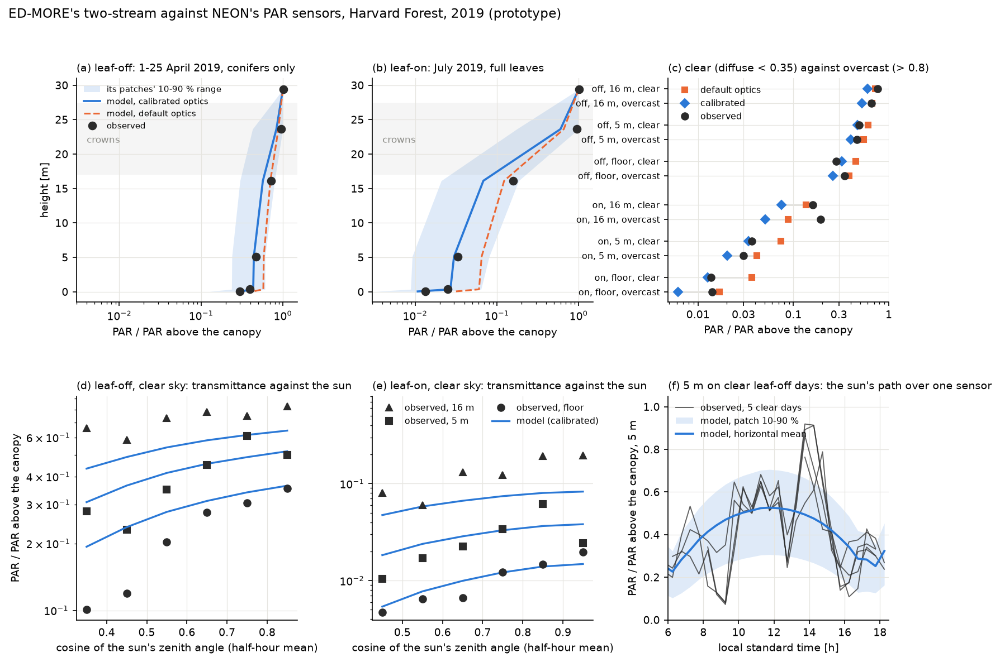

# Example 07 — Canopy radiation against vertical PAR sensors (Harvard Forest) — PROTOTYPE

ED-MORE's two-stream canopy radiation ([`docs/science/canopy_radiation_transfer.md`](../../docs/science/canopy_radiation_transfer.md)),
driven on its own from Python, against the light measured inside a forest. The site is NEON's tower at
Harvard Forest (Massachusetts), with up-facing PAR sensors at 0.36, 5.1, 16.1, 23.6, 29.4 and 39.1 m and three
line sensors on the forest floor, all inside the ForestGEO 35-ha plot.

Two windows of 2019 isolate the canopy's two states:
- **1–25 April, leaf-off:** after the snow (gone on 30 March), before bud break. Only the conifers carry
  leaves, and the bare wood intercepts the rest.
- **July, leaf-on:** full leaves.

March would be leafless too, but in 2019 snow buried the floor sensors and made the ground far brighter than
the model's bare soil. This is a prototype: the pipeline runs end to end, but the fetch script and the README
are not final.

## Run

```bash
cd examples/example07_canopy_radiation
python run_example.py --data <data>        # about 10 s; writes output/
python plot_example.py                     # output/canopy_radiation.png
python calibrate_optics.py --data <data>   # the calibrated optics (calibrated_optics.json), about 6 min
python fit_allometry.py --data <data>      # the Harvard allometry below (optional)
```

It needs a built `libedmore.so` (`build-dev/`, or `EDMORE_LIB`), numpy, pandas, scipy and matplotlib.
`<data>` holds what the fetch scripts download:
- **NEON HARV:** a NEON API token is needed since 2026; the data are CC BY 4.0.
  - tower PAR (DP1.00024.001) and floor line-quantum PAR (DP1.00066.001), 30 min;
  - vegetation structure (DP1.10098.001), for tree heights;
  - foliar traits (DP1.10026.001), for leaf mass per area.
- **Harvard Forest data archive (CC0):**
  - the EMS tower's direct and diffuse PAR (HF004), 134 m from the NEON tower;
  - the 2019 ForestGEO census (HF253);
  - litterfall and LAI-2000 (HF069).
- **MODIS LAI** (MCD15A3H, ORNL DAAC subset).

## The model

- **Drivers.** The PAR measured above the canopy (39 m), split into beam and diffuse by the EMS tower's
  direct/diffuse sensor, with the model's own sun. NEON's own direct/diffuse sensor was shaded by the
  lightning rod until 2025-06.
- **Stand.** Around each sensor, every live stem of the 2019 census within 40 m becomes a cohort in its 20 m
  quadrat's patch. Two PFTs: deciduous and evergreen (the conifers). In April the deciduous trees have no
  leaves; in July all their leaves.
- **Harvard allometry** (`fit_allometry.py`; set on the repository's PFT file in `run_example.py`):
  - **height:** ED-MORE's log-quadratic curve per PFT, fitted to 3,400 trees NEON measured at HARV, each
    DBH class weighted equally, capped at 28 m. The fit is within ~1 m of the measured mean in every DBH
    class, and the tallest tree per patch is 25 m (lidar: 24–27 m).
  - **deciduous leaf area:** scaled (`lai_b1` 0.234 → 0.171) to a July LAI of 3.95 around the towers, the
    median of three sources:
    - leaf litterfall over leaf mass per area: 4.5;
    - MODIS July minus leaf-off: 3.8;
    - LAI-2000 over the default clumping: 3.95.
  - **evergreen leaf area and wood area:** the defaults (conifer LAI 0.55–1.65 around the sensors, WAI
    0.57–0.69).
- **The wood's angle.** The wood surface has its own angle distribution, 75° ± 20° by the repository's
  default, the area-weighted inclination of the woody surface in TLS cylinder models of two leaf-off
  temperate stands. Near-vertical wood intercepts little of a high sun and much of a low one.
- **The calibrated optics** (`calibrate_optics.py` → `calibrated_optics.json`):
  - **Fitted:** leaf clumping, the mean leaf angle and wood clumping, for every PFT, against the sensors
    below the crowns (5 m, 0.4 m, the floor).
  - **Targets, in both windows:** clear-sky light in three bands of the sun's height, and overcast light.
  - **Fit:** a 150-point grid, then Nelder–Mead. Every other optical key is the default.

  | key | calibrated | default | how firmly the data hold it |
  |---|---|---|---|
  | `leaf_clumping` | 0.95 | 0.8 | firmly: the cost doubles at 0.8 |
  | `leaf_angle_mean` [°] | 34 | 45 | loosely: 25–45° fit about as well, 65° worse |
  | `wood_clumping` | 1.0 (its upper bound) | 0.5 | loosely; the bound suggests the allometry's wood area is low |

  The cost (the mean squared log of model over observed) falls from 0.61 with the default optics to 0.16.
  The patches already carry the gaps between crowns, so the clumping within a layer comes out near 1.
- **What a sensor reads.** A sensor at height z reads the downwelling PAR at the top of the tallest cohort
  layer at or below z, or the ground's when none is. The value is averaged over the patches by area: the
  horizontal mean of a 1-D layered canopy. `edmore.canopy.Canopy.radiation` returns this light at every
  cohort's top as `cohort_incid_vis`.

## Results (2019)



PAR at a sensor over the PAR above the canopy, with the sun above ~20°: observed / calibrated / default optics:

| | April, leaf-off | July, leaf-on |
|---|---|---|
| 29 m | 1.02 / 1.00 / 1.00 | 1.01 / 1.00 / 1.00 |
| 24 m | 0.96 / 0.84 / 0.88 | 0.96 / 0.60 / 0.66 |
| 16 m | 0.72 / 0.57 / 0.70 | 0.16 / 0.07 / 0.12 |
| 5 m | 0.47 / 0.44 / 0.59 | 0.033 / 0.030 / 0.065 |
| 0.4 m | 0.39 / 0.43 / 0.58 | 0.025 / 0.027 / 0.061 |
| floor (3 sensors) | 0.26–0.32 / 0.22–0.42 / 0.33–0.57 | 0.009–0.017 / 0.009–0.012 / 0.028–0.034 |

- **Below the crowns, the calibrated two-stream reproduces the light in both seasons** (panels a, b). The
  default optics let about twice the light through in July.
- **The sun's height (panels d, e).** Under a clear sky the floor's light falls as the sun lowers, more
  in the data than in the model.
  - Leaf-off, from cos z 0.85 to 0.35: observed ×0.3–0.6, modelled ×0.65–0.75.
  - The wood's own angle accounts for part of it (×0.75–0.85 with the wood at the leaves' 45°).
  - The rest is the 1-D layers' horizontal uniformity: a low sun crosses whole neighbouring crowns and trunks.
- **Overcast skies (panel c).** The measured light below the crowns is as high under overcast as under clear
  skies (July floor 0.014 and 0.014). The calibrated model's is half (0.007). The two-stream's diffuse light
  comes from an isotropic sky, while an overcast sky is brightest overhead, and zenith light penetrates
  furthest.
- **Inside the crowns (16 and 24 m) the model is too dark.** This is an assumption of ED-MORE: each
  cohort's leaves and wood sit in a thin layer at the tree's top, with no crown depth, so a sensor at 16 m
  has all of a 17–25 m tree's foliage above it. The 24 m sensor also sits beside the tower's own gap.
- **A point sensor against a horizontal mean (panel f).** Each sensor is one point under a 3-D canopy.
  - On clear days the light at 5 m swings from 0.1 to 0.9 as the sun's path crosses gaps and trunks above
    the sensor, and the pattern repeats from one clear day to the next (r = 0.97, half hour by half hour).
  - Under overcast skies the same sensor varies by 4 %.
  - The model gives the patches' mean, which changes only with the sun's height and the sky. Its patches'
    10–90 % range holds 88–93 % of the observed half hours at 0.4 and 5 m.
  - So half hours agree only weakly (log r 0.2–0.45), and the comparison is made over each window's sums.

Not in this example: the near-infrared and thermal bands (the same solver), which a full-band comparison
may add later.

## Files

| File | What it is |
|---|---|
| [`run_example.py`](run_example.py) | the run: drivers, stands, the two-stream in both optics, the comparison table |
| [`calibrate_optics.py`](calibrate_optics.py) | the optics' calibration against the sensors below the crowns |
| [`calibrated_optics.json`](calibrated_optics.json) | its result, which `run_example.py` reads |
| [`harvard_data.py`](harvard_data.py) | the readers: NEON sensors, the EMS split, the census stand with ED-MORE's allometry |
| [`fit_allometry.py`](fit_allometry.py) | the Harvard height and leaf-area allometry, from NEON, HF069 and MODIS |
| [`plot_example.py`](plot_example.py) | the figure |
